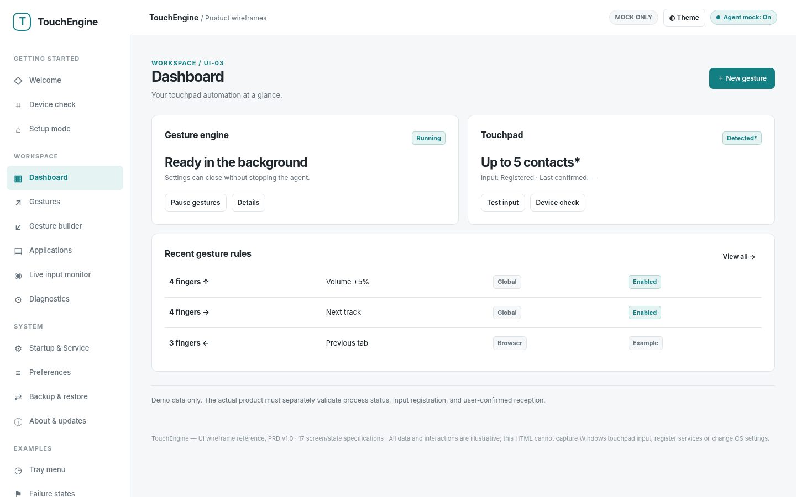
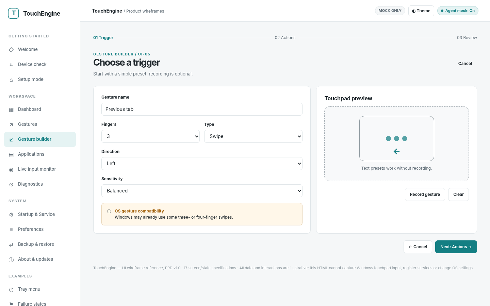

<div align="center">

# Gestouch

### More gestures. Less overhead.

**Make your Windows Precision Touchpad yours.**  
A native, open-source gesture engine written in Rust — built to keep the desktop responsive without keeping a heavy settings window alive.

[](https://github.com/lustresense/gestouch/actions/workflows/windows.yml)


[](LICENSE)

[**Get started**](#get-started) · [**Explore features**](#what-gestouch-brings) · [**Preview the design**](#designed-for-the-desktop) · [**Contribute**](development/CONTRIBUTING.md)

</div>

> [!IMPORTANT]
> **v0.0.1 is an experimental source preview, not a tested stable release.** Windows compilation and physical touchpad compatibility still need validation. No GitHub Release or downloadable installer has been published yet. [See what is and isn't ready](development/docs/IMPLEMENTATION_MATRIX.md).

## Your touchpad deserves more than default gestures.

Windows touchpads can do a lot. **Gestouch explores what happens when you put the shortcuts in your own hands**: control media, change volume, switch tabs, and prototype multi-finger actions — with a native event-driven engine instead of a resident browser UI.

| Focus | What it means |
| :-- | :-- |
| 🖐️ **Custom gesture mapping** | Configure two- to five-finger swipe and tap rules in the alpha Settings app. |
| ⚡ **Native by design** | Rust gesture logic, Win32 input integration, native Settings window. No Electron, Chromium, WebView, or .NET runtime. |
| 🛌 **Sleep-aware** | Recovery hooks for Windows resume and device changes. The PC is allowed to sleep normally. |
| 🧩 **UI when you need it** | The input agent and Settings UI are separate processes. Close Settings; the engine can remain active. |
| 🔐 **Local-first** | Local configuration, no analytics SDK or account requirement, no cloud dependency for runtime operation. |

**Performance numbers are not marketing claims.** Low memory use is a design objective; actual RAM, CPU, latency, and battery impact have **not yet been benchmarked on hardware**.

## Designed for the desktop

<div align="center">

<a href="development/design/preview_dashboard.png"></a>
<a href="development/design/preview_builder.png"></a>

<sub>UI concept previews — not screenshots of shipping v0.0.1. The current native app has five basic pages.</sub>

</div>

Explore the [**interactive UI wireframes**](development/design/WIREFRAMES.html) and [full product specification](development/docs/PRD_Gestouch_v1.0.md). The design includes gesture creation, diagnostics, recovery, startup, and service-mode flows; many are still roadmap items.

## What Gestouch brings

| In the 0.0.1 source preview | On the roadmap |
| :-- | :-- |
| Native Rust gesture recognizer + unit tests | Gesture recorder and richer editing |
| Raw Input / HID input backend (hardware validation pending) | TipTap, edge gestures, per-app profiles |
| Volume, mute, media control, limited shortcuts | Brightness, advanced actions, conflict handling |
| Native Dashboard, Gestures, Diagnostics, Startup, About | Full 17-screen polished Settings experience |
| Per-user autostart and optional experimental SCM supervisor | Hardened multi-session lifecycle and auto-updates |

**Windows gesture caveat:** Gestouch can observe Raw Input where supported, but cannot guarantee suppression of Windows' built-in three- and four-finger actions. Running both bindings may execute both actions. Test your mapping carefully. [Known limitations](development/docs/KNOWN_LIMITATIONS.md).

## Get started

**Requirements:** Windows 11 x64 with a Windows Precision Touchpad, PowerShell 5.1+, Visual Studio Build Tools (MSVC C++ workload + Windows SDK), and internet access for the first Rust dependency build. Rustup can be installed through `winget` by the build script if needed.

Open PowerShell in the cloned repository:

```powershell
 git clone https://github.com/lustresense/gestouch.git
 cd gestouch
 powershell -NoProfile -ExecutionPolicy Bypass -File .\development\build.ps1
```

The **single build command** formats source, runs unit tests, builds Windows binaries, and packages a portable ZIP in `dist/`. It **does not install** anything unless requested.

To build **and** enable per-user startup:

```powershell
powershell -NoProfile -ExecutionPolicy Bypass -File .\development\build.ps1 -Install
```

For optional **experimental Windows Service supervisor** (elevated PowerShell):

```powershell
powershell -NoProfile -ExecutionPolicy Bypass -File .\development\build.ps1 -Install -Service
```

The actual gesture agent runs in the **interactive user session**, not Session 0. A Windows Service alone cannot operate the user's desktop. The supervisor is optional and may consume additional resources.

For complete setup, maintainer build instructions, troubleshooting, performance sampling, and release gates, see the [**Development Hub**](development/README.md).

### Try your first gesture

After building, launch `gestouch-agent.exe`, then `gestouch-settings.exe` from `dist/Gestouch-0.0.1-win-x64/`. Add a swipe or tap rule on **Gestures** and inspect **Diagnostics** for input counts. Settings can close while the agent continues running.

**Nothing overrides your Windows bindings by default:** custom Gestouch rules start empty, and any overlap with built-in Windows gestures remains your responsibility in this alpha.

## Built differently

```text
Windows Precision Touchpad
          │
   Win32 Raw Input / HID
          │
   gestouch-agent (Rust) ────── gestouch-core (recognition)
          │                         │
       Win32 actions           config.toml
          │                         │
   Windows desktop         gestouch-settings (on demand)
          
Optional: gestouch-service (SCM supervisor → user startup task)
```

The engine uses an event-driven Windows message loop rather than continuously polling finger coordinates. It does **not** prevent system idle or sleep; resume recovery is under test. [Architecture](development/docs/ARCHITECTURE.md).

## Open source, and built in the open

Gestouch is released under the **[GNU GPL v2.0 only](LICENSE)** (`GPL-2.0-only`). This Rust codebase was developed independently after studying [GestureSign V2](https://github.com/Tomclanc/GestureSignv2) and the original [GestureSign](https://github.com/TransposonY/GestureSign), both GPL-2.0 projects. **Gestouch is not currently a GitHub fork of their repository, and no upstream C# source is included in v0.0.1.** We credit their work and chose the same GPL version for this project. See [provenance](development/docs/PROVENANCE.md).

Want to help make touchpad gestures better? **Test on real hardware, report HID quirks, improve the recognizer, or refine the Settings UI.** Contributions are welcome under the project's GPL license.

[**Contributing**](development/CONTRIBUTING.md) · [**Report a bug / request a feature**](https://github.com/lustresense/gestouch/issues) · [**Security**](SECURITY.md) · [**Changelog**](CHANGELOG.md)

<div align="center">

---

**Gestouch · Make every touch count.**  
If this project is useful or you want to follow its progress, consider starring the repository.

</div>
