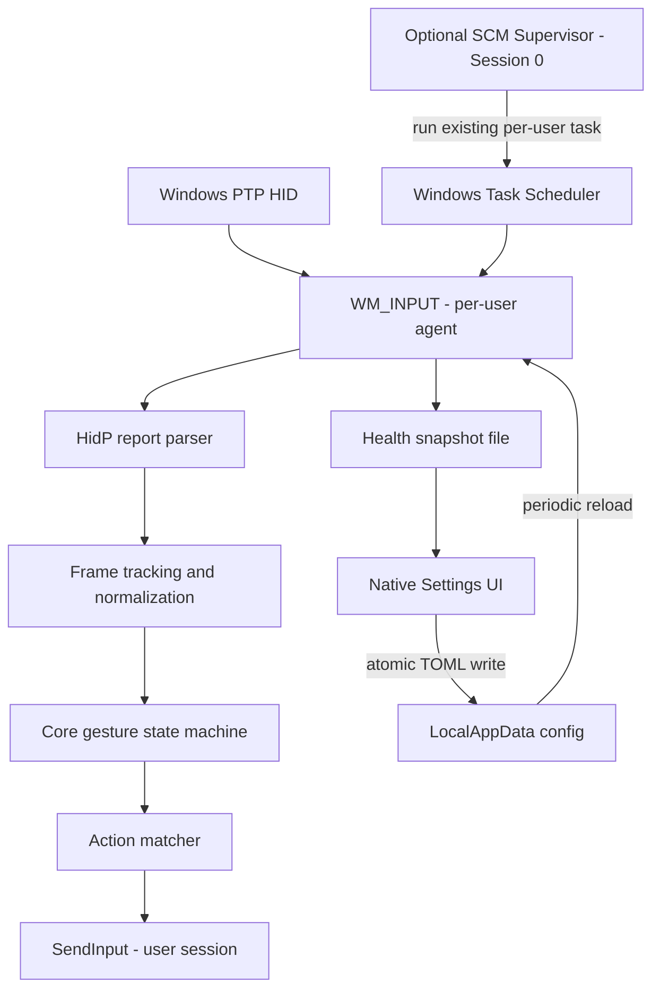

# Gestouch v0.0.1 — Implementation architecture

## Process boundaries

The Windows service cannot and must not inject key events or access raw HID input in Session 0. It has only a fixed scheduled-task restart responsibility. The current alpha uses Task Scheduler and periodic supervision, which is intentionally simpler than a secured named-pipe protocol; not a complete per-user authenticated multi-session supervisor.

## Touchpad

- Device usage pair: HID Digitizers page `0x0D`, Touch Pad usage `0x05`.
- Register for `WM_INPUT` with `RIDEV_INPUTSINK | RIDEV_DEVNOTIFY` to a message-only window.
- Read raw HID reports with `GetRawInputData`. Read device's HID preparsed data with `GetRawInputDeviceInfoW`, inspect `HidP_GetCaps`, `HidP_GetValueCaps` for logical X/Y ranges.
- Use `HidP_GetUsageValue` (contact count and ID, X/Y) and `HidP_GetUsages` (tip status). Normalize to 0..10,000 per axis.
- Assemble HID contact batches conservatively and reject incomplete/invalid frames. Device unplug/replug and resume cancel tracking and re-register.
- **Hardware qualification gate:** devices may report contact count and release differently. The decoder is unverified and may require fixes after obtaining real trace logs. A background process receiving reports does not mean it can suppress Windows-native gesture behavior.

## Gesture state machine

- Pure-Rust `gestouch-core` is isolated from platform APIs so synthetic frames can be tested on any Rust environment.
- 2–5 contacts, swipe (left/right/up/down) or tap, emitted once after complete release.
- Each finger must move consistently in the same direction, debounce applies, stale state resets, malformed duplicates rejected.
- Swipe threshold 11.5% of logical device width/height; tap tolerance 2.8%; values are **provisional** and require calibration on multiple devices.
- Known alpha trade-off: swipe uses mean deltas and axis threshold in the same normalized space; no diagonal recognizer, no hold/TipTap/edge logic.

## Sleep and idle

- The Win32 message queue blocks when there is no input. No artificial cursor movement or Windows sleep inhibition.
- Health check every 30s validates registration ownership. Silence alone is not a failure signal.
- Resume/device changes schedule re-registration after 700ms and clear stale contacts.
- Config reload every 5 seconds lets Settings remain stateless while agent processes gestures.
- Watchdog service mode is optional and costly enough to be excluded from default install.

## Data privacy and action safety

- Configuration only in current user's LocalAppData. Only allowlisted keyboard shortcuts (modifiers, alphanumeric, function/navigation keys) are accepted; no arbitrary shell commands in alpha.
- No telemetry and no raw coordinate streaming to network.
- The status file is untrusted for monitoring (not an IPC command channel).
- Windows UIPI limitations apply: `SendInput` may not control elevated/protected applications.

## Quality gates

- **G0:** real Precision Touchpad raw reports and correct assembled contacts.
- **G1:** compilable Windows x64 binaries; Win32 UI opens and `SendInput` behaves as expected.
- **G2:** restore after sleep/resume, no input stalls for idle >8h.
- **G3:** verified clean install/update/uninstall and SCM isolation.
- **G4:** measured CPU + memory + battery; no performance claims before evidence.

For design completeness see `PRD_Gestouch_v1.0.md` and the interactive `WIREFRAMES.html`.
