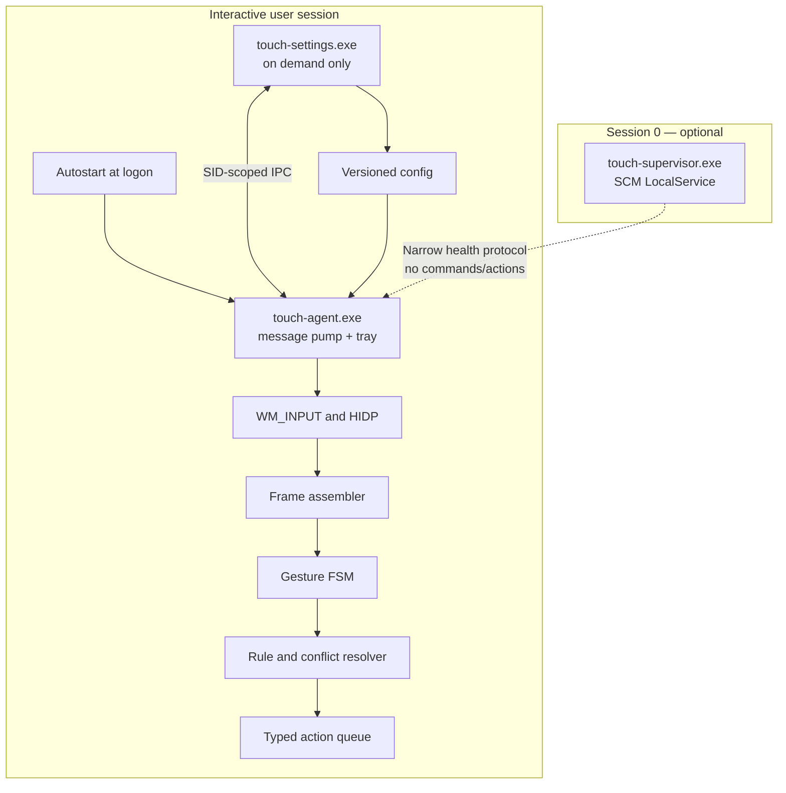
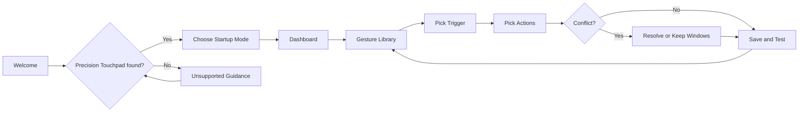
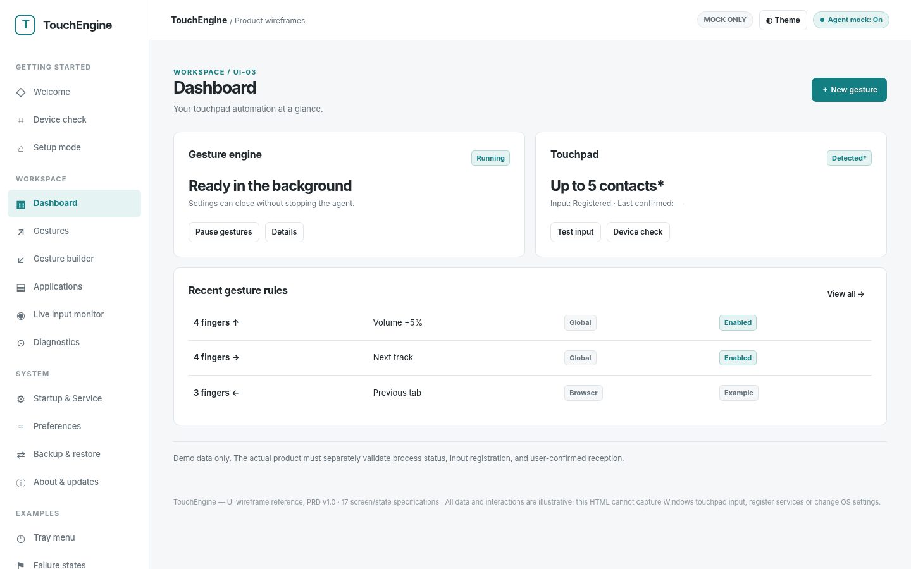
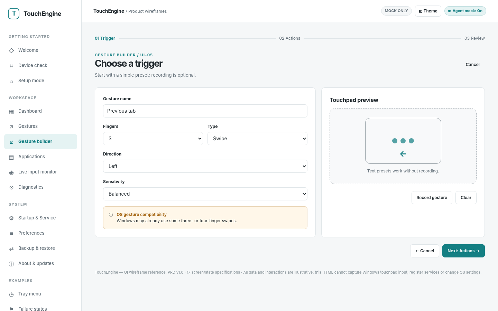
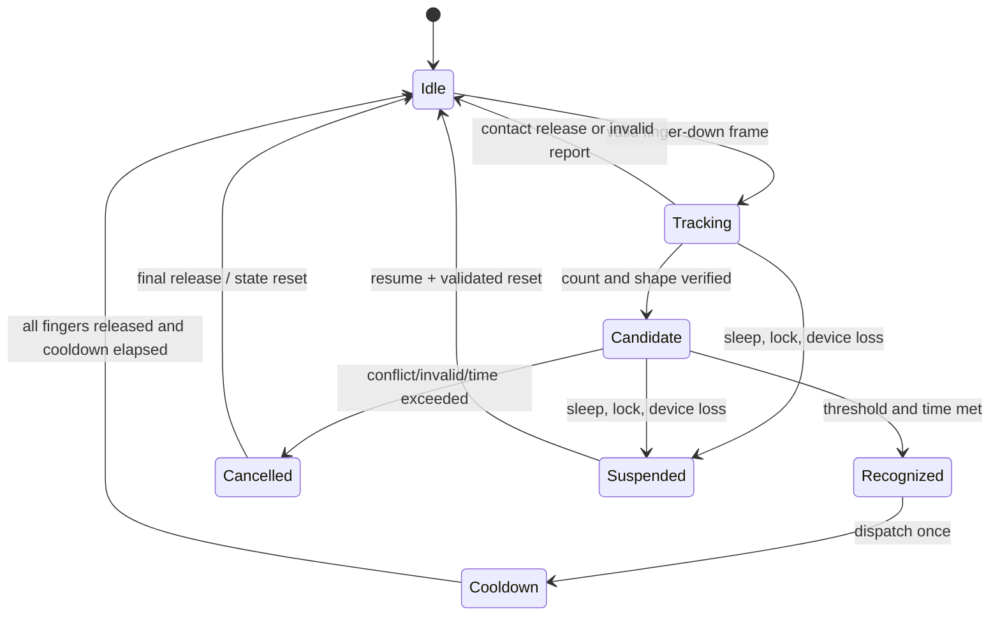
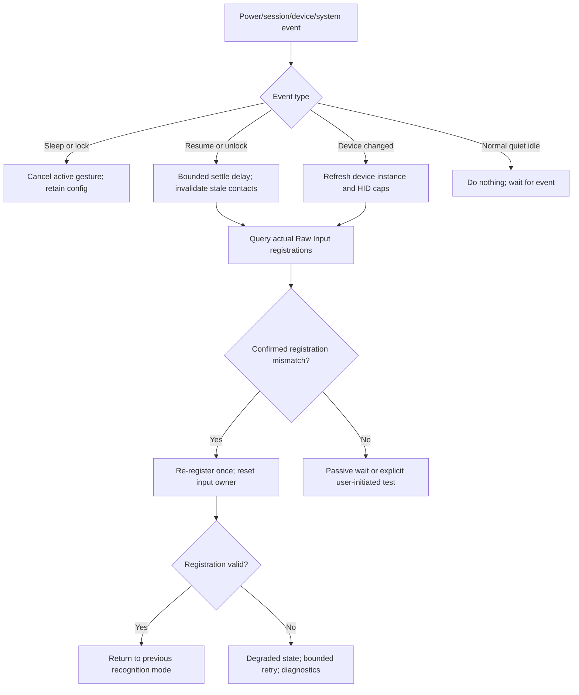

# PRODUCT REQUIREMENTS DOCUMENT — Native Windows Touchpad Engine

> **PRD v1.0 — implementation handoff candidate, research-gated**  
> **Current implementation:** Gestouch 0.0.1 developer preview. This document specifies the broader product vision; features not shipped in 0.0.1 are tracked in `IMPLEMENTATION_MATRIX.md`.  
> **Date:** 16 November 2026 · **Platform:** Windows 11, x64 first · **Product name:** `Gestouch` · **GitHub repository:** `gestouch` · **First software milestone:** `0.0.1`  
> **Status:** Architecture, UX, data contract, release criteria specified; **Phase 0 hardware feasibility and physical performance validation NOT completed**.  
> **Companion:** `WIREFRAMES_Interactive.html` (clickable low-fidelity layouts). Every core flow is specified and wireframed *also inside this PRD*. See `preview_dashboard.png` and `preview_builder.png` for static thumbnails.  
> **Upstream source baseline:** `Tomclanc/GestureSignv2` commit `8e331791ca7c203a15f707871b803c2e94c63749` (2026-11-16). Root license GPL-2.0.  
> **Legal strategy:** independent Rust codebase, proposed `MIT OR Apache-2.0`; this is **not** a relicense or line-by-line translation of GPL code.

## 0. How to use this PRD

This is the single product and engineering decision record for implementation. `MUST` = release-blocking; `SHOULD` = expected unless documented exception; `MAY` = optional. Priority codes: **P0** = MVP, **P1** = stable v1, **P2** = later. Every requirement has an ID and corresponding acceptance gate. A visual wireframe describes hierarchy and interactions, not a promise of precise native Win32 pixel equivalence. The companion HTML illustrates navigation and layout only and is not the released application or a reusable production UI library.

### 0.1 Sign-off gates and important uncertainties

| Gate | Required evidence | Result today |
|---|---|---|
| G0: Input feasibility | On a physical Windows Precision Touchpad, `WM_INPUT` supplies per-contact data in background for target gestures; Windows conflict behavior documented | **OPEN — must test** |
| G1: Technical architecture | Rust x64 debug/release builds, parsers and lifecycle tested, startup verified | **OPEN** |
| G2: UX specification | All screens, interactions, errors, accessibility paths and visible copy defined | **SPECIFIED here; not user-tested** |
| G3: Security | Signed/validated release path, scoped IPC, no unintended privilege bridging, dependency/asset license review | **OPEN** |
| G4: Performance | Repeated physical benchmarks, not estimates | **OPEN** |
| G5: Stable release | Acceptance matrix green, clean upgrade/uninstall, restore after sleep/resume | **OPEN** |

**Do not start UI implementation before G0.** If touchpad reports are inaccessible or Windows owns a particular 3/4-finger motion, do not claim fully programmable global gestures; adjust feature availability and disclose limitations. G0 failure is a legitimate stop/go outcome.

---

# PART A — Product definition and scope

## 1. Executive brief

**Problem:** Windows Precision Touchpad users want custom gestures beyond Windows defaults. Existing utilities can use heavier UI stacks and suffer cases where the process exists but gesture processing stalls. The desired replacement must be lightweight while idle, immediately responsive on use, native on Windows, respectful of existing Windows gestures, and recover automatically after documented input failures.

**Product promise:** “Make your Windows touchpad programmable without turning your laptop into a background-app host.” More concretely: a **per-user Rust input agent** starts on login and needs no configuration window to operate. The **optional genuine Windows Service** starts on boot and supervises availability only; Session 0 must never capture gestures or run user actions. The UI is a separate on-demand process.

**Anti-idle definition:** If Windows is awake and the user does not touch the pad for hours, the agent must remain armed with practically zero idle CPU; inactivity **cannot itself** trigger reset. On suspend/hibernate the process may suspend normally. After resume/unlock/device re-enumeration, the agent must recover from stale frames and invalid registrations. Never fake pointer movement or prevent Windows from sleeping.

**Success signals:** gesture success rate, p95 recognition latency, no duplicate triggers, no spurious recovery, low memory and CPU over real idle/active traces, startup reliability, rapid diagnosis of unsupported hardware.

## 2. Personas and jobs-to-be-done

| Persona | Core job | Primary feature |
|---|---|---|
| Power user | Make 4-finger volume/media gestures coexist with extra custom actions | Conflict-aware gesture library |
| Developer | Bind different gestures to VS Code, terminal, browser | App profiles, activation matching |
| Laptop/battery-conscious user | Keep utility running all day without heavy UI process | Lean event-driven agent and on-demand settings |
| Maintainer | Diagnose a no-gesture-after-resume report without guesswork | Health snapshots, ring buffer, synthetic input replay |
| Advanced operator | Install a real SCM supervisor deliberately | Service Mode, clear UAC/privilege separation |

### 2.1 Jobs / explicit outcomes

- J01: Install as a standard user, enable startup, perform first gesture without learning HID concepts.
- J02: Preserve existing Windows four-finger commands unless the user intentionally reassigns them.
- J03: Create “3-finger swipe left → previous tab in browser” with live validation and undo.
- J04: Pause/resume all custom gestures from tray without turning off Windows touchpad settings.
- J05: Close Settings and continue using gesture automation normally.
- J06: Resume from sleep and receive input with no UI restart or privileged action.
- J07: See whether engine is running, **input healthy**, action blocked, or hardware unsupported, without conflating states.
- J08: Choose genuine Service Mode at install time, obtain correctly scoped supervision and clean uninstall.

## 3. In scope / out of scope

| Capability | P0 | P1 | P2 / excluded |
|---|---|---|---|
| Windows 11 x64 Precision Touchpad | Yes | Windows vendor coverage | ARM64 after native gate |
| Swipe 3–5 fingers, taps and simple hold | Yes after G0 | TipTap, physical pad edge | Touchscreen, pen, mouse drawing |
| Volume/media/hotkey/window actions | Yes | Brightness, app launch, multi-step sequencing | Script execution / plugins by default |
| Global + per-app profiles | Global + 1 app | Full matching/rule precedence | Cloud sync |
| Conflict warnings | Yes | Guided Windows Settings handoff | Claims of universal OS gesture suppression |
| Auto start and startup diagnostics | Yes | Optional true SCM service | Kernel drivers |
| Tray pause/resume | Yes | Quick profile switch | Radial menu integration |
| Health and self-repair | Yes | Support bundle + detailed telemetry controls | Always-on cloud analytics |
| Native Settings UI | Primary screens | All specified advanced screens | Continuous web renderer, Electron, AI |
| Import/export | Versioned own format | Preview/rollback | Unreviewed legacy GPL converter |

**Non-goals (all releases unless consciously amended):** prevent idle/sleep; use SYSTEM to send shortcuts into the desktop; bypass UAC/secure desktop; capture keystrokes/text; intercept protected windows; install unsigned kernel filters; provide unbounded plugin DLL loading; silently change Windows touchpad preferences; promise gestures on non-Precision pads.

## 4. Prioritized functional requirements

| ID | Requirement | Priority | Proof |
|---|---|---|---|
| FR-01 | Detect supported physical touchpad; show device identity, capability, permission/error state | P0 | E2E-01 |
| FR-02 | Raw input registration works with UI closed and app in foreground/background | P0 | E2E-02 |
| FR-03 | Multi-report frame assembly by contact ID, scan time, count, tip state | P0 | TEST-INPUT |
| FR-04 | Gesture matching never fires for incomplete/orphan/malformed frame | P0 | TEST-INPUT |
| FR-05 | Global 3/4/5-finger swipe; directions and tap only where device confirms | P0 | E2E-03 |
| FR-06 | Create, edit, clone, enable/disable, delete rule with undo | P0 | E2E-04 |
| FR-07 | Default behavior does not hijack user's Windows gestures silently | P0 | E2E-05 |
| FR-08 | Per-app matching; explicit global fallback and ignored apps | P1 | E2E-06 |
| FR-09 | Action dispatch: media, volume, safe hotkey, window commands | P0 | E2E-07 |
| FR-10 | Brightness capability detection and informative unsupported mode | P1 | E2E-08 |
| FR-11 | Pause/resume from tray and Settings; Windows gestures remain unaffected | P0 | E2E-09 |
| FR-12 | Start automatically at interactive logon; prevent duplicate agents | P0 | E2E-10 |
| FR-13 | Installer can register an **actual SCM service** in Service Mode with UAC | P1 | E2E-11 |
| FR-14 | Service never receives raw gesture events nor executes shortcut/scripts | P0 security | TEST-SEC |
| FR-15 | Recover from verified registration corruption, resume, device change, stale contact | P0 | E2E-12 |
| FR-16 | No reset/restart merely for zero input while idle | P0 | E2E-13 |
| FR-17 | Show action/gesture recognition status and last event locally | P0 | E2E-14 |
| FR-18 | Diagnostics exported only with explicit selection and user consent | P1 | E2E-15 |
| FR-19 | Settings process exits cleanly without terminating agent | P0 | E2E-16 |
| FR-20 | Config update validated transactionally, with last-known-good and rollback | P0 | TEST-CONFIG |
| FR-21 | Native UI keyboard navigation and High Contrast support | P0 | TEST-A11Y |
| FR-22 | Import/export preview and collision report | P1 | E2E-17 |
| FR-23 | Foreground privacy: never store input coordinates by default | P0 | TEST-SEC |
| FR-24 | Startup/repair status distinguish “Running”, “Healthy”, “Paused”, “Unsupported”, “Recovering” | P0 | E2E-18 |
| FR-25 | Explicit update check, verified artifacts and upgrade rollback | P1 | E2E-19 |
| FR-26 | Advanced optional command execution with trust confirmation and bounded runtime | P2 | TEST-SEC |

---

# PART B — Research-backed architecture decisions

## 5. Technical evidence and conclusions

**Verified upstream** (`Tomclanc/GestureSignv2`, SHA above): top-level projects include `GestureSign.Daemon`, `GestureSign.WinUI`, `GestureSign.Common`, `GestureSign.CorePlugins`, `GestureSign.PointPatterns`, `GestureSign.Foundation`, `GestureSign.IntentDlc`, plus support libraries and installer. `MessageWindow.cs` subscribes to `WM_INPUT`; `InputProvider.cs` listens for session/power events and runs a 30-second health timer; `PointCapture.cs` can cancel/recover; `MainWindow.xaml.cs` registers Startup shortcut or an administrator Scheduled Task (not SCM service); `PluginManager.cs` loads plugin assemblies; the root LICENSE is GNU GPL version 2. All observations are source *inspection*, not confirmed execution or vulnerability proof. See Appendix source links.

**External platform facts:**

1. Raw Input requires `RegisterRawInputDevices`; `RIDEV_INPUTSINK` allows background delivery; `RIDEV_DEVNOTIFY` emits arrival/removal notifications. Only one target HWND per device class *within one process* should register; avoid registering from unrelated libraries. [Microsoft](https://learn.microsoft.com/en-us/windows/win32/api/winuser/nf-winuser-registerrawinputdevices)
2. Windows Precision Touchpad specification supports **3 to 5 concurrent contacts**, and mandates contact-count and scan-time semantics; fragmented reports and contact-ID lifetime matter. [Microsoft](https://learn.microsoft.com/en-us/windows-hardware/design/component-guidelines/touchpad-windows-precision-touchpad-collection)
3. Windows Services cannot directly interact with the user's desktop; the interactive agent must run in its own session. [Microsoft](https://learn.microsoft.com/en-us/windows/desktop/services/interactive-services)
4. `WTSQueryUserToken` requires LocalSystem with `SE_TCB_NAME`; **not** an acceptable shortcut for a LocalService supervisor design. [Microsoft](https://learn.microsoft.com/en-us/windows/win32/api/wtsapi32/nf-wtsapi32-wtsqueryusertoken)
5. `SendInput` is subject to UIPI; equal-or-higher integrity limitations must be disclosed, not bypassed. [Microsoft](https://learn.microsoft.com/en-us/windows/win32/api/winuser/nf-winuser-sendinput)
6. Per-monitor V2 DPI requires handling `WM_DPICHANGED` and layout resizing; Win32 control scaling is not entirely automatic. [Microsoft](https://learn.microsoft.com/en-us/windows/win32/hidpi/high-dpi-desktop-application-development-on-windows)
7. Shortcut conflict disclosure, startup setting, backup/restore, diagnostics, and neutral-light/dark settings navigation have useful UX precedents in Microsoft's PowerToys. Design inspiration **not copied source/UI assets**. [Microsoft](https://learn.microsoft.com/en-us/windows/powertoys/general)

### 5.1 Decision records (ADRs)

| ADR | Decision | Alternative rejected | Trade-off / revisit |
|---|---|---|---|
| ADR-01 | Native Rust engine (`windows-sys` narrow features) | C#/.NET direct port, Electron | FFI work + unsafe boundary review, but no resident runtime dependency |
| ADR-02 | Win32 hidden HWND + Raw Input + HIDP parser | `WM_POINTER` as global source, custom driver | Raw access **must** pass Phase 0; no guaranteed OS gesture suppression |
| ADR-03 | Single threaded input message pump + separate bounded action executor | Busy-poll background thread | Deterministic event loop, lower idle wakeups |
| ADR-04 | Native Win32/common-controls Settings in **separate process** | Always-on web UI | Styling takes engineering, but resident agent remains tiny |
| ADR-05 | P0 no dynamic plugin loading | DLL-per-action plugins | Smaller trusted codebase; typed built-in actions first |
| ADR-06 | Light Mode as default; Service Mode real optional SCM | Always-on LocalSystem input service | Correct Windows security and lower base cost |
| ADR-07 | User-scoped named pipes; service receives only narrow health protocol | Generic unrestricted cross-user pipe | More complexity, much smaller privilege boundary |
| ADR-08 | TOML schema with atomic write, versioned migration | Reuse upstream JSON/GPL reader code | Friendly configuration; explicit import migration later |
| ADR-09 | Windows gestures default to priority | Automatically disable Windows gesture mapping | Cannot promise OS suppression; consent/compatibility first |
| ADR-10 | Release only after physical PTP test | Shipping on synthetic tests alone | Requires hardware matrix but prevents false support claims |
| ADR-11 | UI text ships English first, Indonesian localization later | Incomplete mixed-language UI | Consistent controls and translations; all strings externalizable |

### 5.2 Performance rationale

A different programming language does not fix an orphan HID contact or a Windows driver restriction. The practical wins are: one runtime-independent agent, avoiding per-frame allocation where possible, bounded caches, UI off the resident path, no continuous AI/ML/overlay, and event-driven sleep. Native Win32 UI does not imply modern appearance automatically; see Part C for precise design requirements and accessible implementation strategy.

### 5.3 Recommended Rust workspace

```text
touch-engine/
  Cargo.toml                    # workspace; edition/Rust toolchain pinned in rust-toolchain.toml
  crates/
    core/                       # pure Rust frame, gesture, rule and conflict logic
    hid-protocol/               # descriptor/report decode with bounds checks
    win-input/                  # Raw Input, HWND, power, device notifications
    win-actions/                # typed Win32 actions and capability probes
    config/                     # schema, migration, atomic persistence
    ipc/                        # versioned protocol, named pipe and ACL
    agent/                      # per-user process, tray and orchestration
    settings/                   # separate Win32/native controls UI
    supervisor/                 # OPTIONAL LocalService SCM process
    diagnostics/                # counters and opt-in support bundle
    testkit/                    # synthetic frames and replay
  installer/                    # WiX or evaluated native MSI pipeline
  assets/                       # original monochrome assets only
  tests/                        # integration, adversarial, physical test scripts
  docs/                         # help, security, device support, architecture
  .github/workflows/           # format, clippy, test, build, SBOM, release
  LICENSE-MIT  LICENSE-APACHE
  SECURITY.md CONTRIBUTING.md CHANGELOG.md README.md
```

**Dependency rule:** prefer standard library, `windows-sys`/`windows`, `serde`, `toml`, `thiserror`, small IPC primitives; every crate must be justified with version, license and package size. Audit `unsafe` at each FFI boundary, separate from pure Rust recognizer. No Tokio runtime is required for `WM_INPUT`; only add an async executor if measured I/O needs prove it. No OpenTelemetry/cloud SDK in agent.

### 5.4 Process diagram



---

# PART C — Complete UX/UI specification

## 6. Visual design and interaction philosophy

The reference UI should feel like a restrained Windows settings utility, **not** an AI-generated dashboard. Neutral layers, restrained teal/blue accent only for active affordances, no gradients, glass overload, emojis, oversized cards, or decorative charts. Feature discoverability matters more than visual novelty. Interface references: PowerToys general settings for discoverability; Windows 11 navigation for hierarchy; use original iconography, not copied icons/screenshots. **Companion HTML uses the working title “Gestouch”** and represents a wireframe, not final branding.

### 6.1 Layout and spacing tokens

| Token | Specification |
|---|---|
| Primary window | 1120 × 740 dp default; minimum 820 × 580 dp; resizable and remembers dimensions |
| Navigation | Left rail 222 dp; collapse to icons + tooltip at content width < 960 dp |
| Content | max width 980 dp; primary inner padding 32 dp; gap 16/24 dp |
| Sidebar row | 42 dp; grouped: Workspace, System, Help |
| Typography | Segoe UI / Segoe UI Variable if present, fallback system UI; title 24/28 semibold, section 16/20 semibold, body 13–14/20 |
| Radius | Controls 6 dp, cards 8 dp, dialog 10 dp; no exaggerated pills |
| Colors light | bg `#F8F9FA`, surface `#FFFFFF`, text `#1F252B`, muted `#66717C`, border `#E3E6EA`, accent `#137C80` |
| Colors dark | bg `#13171B`, surface `#1B2025`, text `#EAF0F2`, muted `#9DA7AF`, border `#343B42`, accent `#6CBCC1` |
| Status semantics | Healthy = stable icon+text; Warning = amber icon+text; Error = red icon+text; Paused = neutral icon+text; never rely solely on color |
| Motion | 120–180ms for basic transitions; respect Reduced Motion; no continuous idle animation |
| Touch targets | at least 32 × 32 dp desktop, important primary controls 36+ dp |
| Icons | Thin/regular 16–20 dp vectors; consistently one family; no paid/copied vendor icons |
| Breakpoints | 1120+ full labels, 820–1119 compact, <820 prevent shrinking below min; scroll content not sidebar |
| Themes | Follow Windows default; Light/Dark override; **System High Contrast must override custom colors** |

### 6.2 Accessibility and native implementation contract

- Visible keyboard focus ring for each actionable control; Tab order follows reading order; Enter activates focused button; Space toggles switch; Esc closes dialog/recorder without saving.
- Navigation screen reader names and explicit roles via native controls/UI Automation as applicable. Custom-drawn gesture canvas has an accessible text equivalent (“3 fingers, swipe left”), never the only means to define a gesture.
- Use native common controls wherever practical; owner-draw only if UIA provider, focus, keyboard selection and high-contrast states are implemented and tested.
- Search results announce total count; validation errors link or focus to the erroneous field. Do not rely solely on color to communicate conflicts.
- Capture UI accessible without a gesture: preset dropdown, finger count selector, direction selector, test button; recording is enhancement rather than requirement.
- 100%, 125%, 150%, 200% DPI; multi-monitor per-monitor V2; left-to-right language v1. Responsive reflow must not clip dialogs or buttons.
- All primary UI strings externalized (`en-US`); future `id-ID` is added as a *complete* locale, not mixed labels. Error copies in section 14.

## 7. Information architecture, routes and ownership

| Screen ID | Name / UI route | Entry | Primary action | Exit |
|---|---|---|---|---|
| UI-00 | First-run welcome | first launch / reset setup | Start setup | UI-01 |
| UI-01 | Device check | wizard / Settings > Devices | Run capability test | UI-02 or unsupported guide |
| UI-02 | Startup choice | wizard / System > Startup | Light/Service/Portable choice | UI-03 |
| UI-03 | Dashboard | default main | Add gesture / diagnose | UI-04/UI-09 |
| UI-04 | Gesture library | sidebar Gestures | Add, edit, filter, enable | UI-05 |
| UI-05 | New gesture: trigger & record | library Add | Choose input, finger count, gesture | UI-06 |
| UI-06 | New gesture: action sequence | step 2 / edit binding | Pick actions, order, validate | UI-07 |
| UI-07 | Rule review + conflict | step 3 / conflicting rule | Save / resolve / cancel | UI-04 |
| UI-08 | Application profiles | sidebar Apps | Add/app matching/exclusions | UI-04/UI-05 |
| UI-09 | Live input monitor | Dashboard / Diagnostics | Test reception, diagnostic snapshot | UI-10 |
| UI-10 | Diagnostics & recovery | sidebar Diagnostics | Health check/recover/export | UI-03 |
| UI-11 | Startup & Service | System > Startup | Enable at logon / install service | UI-03 |
| UI-12 | Preferences | System > Preferences | Theme, feedback, power, privacy | return |
| UI-13 | Backup/restore | System > Data | Export / dry-run import | return |
| UI-14 | About & updates | Help > About | Check update, view licenses | return |
| UI-15 | Tray quick menu | notification area | Pause, Settings, status, Exit | remains in agent |
| UI-16 | Exception states | contextual | Retry, fallback, help | origin |

**Shell navigation:** Dashboard, Gestures, Apps, Diagnostics; System group: Startup & Service, Preferences, Backup; Help: About. First-run Wizard is separate from shell and may be resumed later. `Ctrl+,` opens Preferences; `Ctrl+N` creates rule from library; `Ctrl+F` focuses search; `Ctrl+S` saves editor; `Esc` discards/cancels after confirmation if dirty; `F1` help. Back button preserves state except when user explicitly discards.

## 8. Primary journey maps



### Journey J-04: diagnostic after seemingly alive-but-stuck agent

Dashboard shows `Agent running · Input status unknown` rather than “Healthy” based only on a live process. User opens Diagnostics. Read-only snapshot lists registered device, source state, frame completion ratio and last **observed** input; there is no statement that “nothing touched” means broken. “Test input” prompts user to move 2 fingers on pad. If raw reports do not arrive in a supported context and registration mismatch can be verified, offer targeted recovery. Otherwise show “Input not confirmed” and collect device/log details. Settings can explicitly ask for `Recover Input`, preserving rules and not emitting half-completed gestures.

## 9. Wireframes and screen specifications

Visual examples generated from the standalone HTML wireframe (original layouts, mock data only):





The Markdown diagrams below preserve the main controls in text form, so the PRD remains implementable even if HTML preview assets are unavailable.

**Notation:** `[ ]` = control, `( )` = radio, `◉` = active, `→` navigation; content in boxes is layout-level mock only. Actual interactive HTML contains mock state transitions for review; implementation must follow functionality in this PRD.

### UI-00 — Welcome (first run, no sidebar)

```text
┌───────────────────────────────────────────────────────────────────┐
│ Gestouch                                         —    □    ×    │
│                                                                   │
│                 Customize your touchpad                           │
│           Native gestures. Minimal background use.               │
│                                                                   │
│   [✓] Keep Windows gestures unless you change them               │
│   [✓] Starts with Windows only if you choose                      │
│   [✓] No cloud account or input collection                        │
│                                                                   │
│           [ Learn how it works ]       [ Get started → ]         │
└───────────────────────────────────────────────────────────────────┘
```

- **States:** initial, returning setup interrupted, version upgrade (should bypass onboarding). Show supported OS minimum and privacy one-line summary. No login, no usage analytics prompt.
- **Interaction:** Get started runs capability scan (UI-01) without UAC. Cancel closes Settings, does not launch auto-start task.
- **Acceptance UX-00:** keyboard reachable, no hidden install changes, understandable within 30 seconds.

### UI-01 — Device compatibility and input test

```text
┌───────────────────────────────────────────────────────────────────┐
│ Setup  ·  1 Device  ─  2 Startup  ─  3 Done                       │
│ Check your touchpad                                               │
│                                                                   │
│  Detected device                   Test                           │
│  ┌────────────────────────────┐  ┌───────────────────────────┐    │
│  │ Precision Touchpad          │  │ Place 2 fingers and move │    │
│  │ Report receiver: Registered│  │                           │    │
│  │ Contacts: up to 5 [probe]  │  │  ○      ○                 │    │
│  │ Device identity: [details] │  │ Frame received: [No/Yes] │    │
│  └────────────────────────────┘  └───────────────────────────┘    │
│  [ Recheck ]     [ Device details ]               [ Continue → ]  │
└───────────────────────────────────────────────────────────────────┘
```

- **States:** scanning (spinner bounded 10 sec), supported, partial support, unsupported/no device, device disabled, driver access failure.
- **Safety:** Preview raw contact circles in RAM only; **not** recorded by default. Do not say “5 fingers” if report capability unknown; show `Unknown` until probe verifies it.
- **Unsupported:** Continue disabled for gesture feature; offer `Open Windows Touchpad Settings`, `Copy Diagnostic Summary`, `Retry` and allow installing diagnostic-only mode separately. Never fabricate compatible hardware.
- **UX-01:** 2-finger test displays only frame count/contact count, not screen coordinates or app title.

### UI-02 — Startup mode selection

```text
┌───────────────────────────────────────────────────────────────────┐
│ Setup · 1 ✓  ─  2 Startup  ─  3 Done                              │
│ How should Gestouch run?                                       │
│                                                                   │
│  ◉ [ Light Mode · Recommended ]                                   │
│    Agent starts when you sign in. No administrator access.       │
│                                                                   │
│  ○ [ Service Mode · Advanced ]                                    │
│    Adds a real Windows Service supervisor + user-session agent.  │
│    Requires administrator approval once. Uses more memory.       │
│                                                                   │
│  ○ [ Portable ]                                                   │
│    Manual launch; optional startup from Settings later.          │
│                                                                   │
│  [← Back]                  [ Install & finish → ]                 │
└───────────────────────────────────────────────────────────────────┘
```

- **Default:** Light Mode. Service Mode needs an explanation drawer including Session 0 and service account; UAC occurs only on install/service change. Portable install never secretly registers task or service.
- **States:** installing, UAC declined (return to choice; do not leave half-installed service), task registration failed, configured.
- **UX-02:** `Install & finish` installs only selected components. Provide progress and rollback.

### UI-03 — Dashboard (home)

```text
┌───────────────┬───────────────────────────────────────────────────┐
│ Gestouch   │ Dashboard                         [ + New gesture]│
│ Dashboard  ●  │                                                   │
│ Gestures      │ ┌──────────────────┐ ┌────────────────────────┐   │
│ Applications  │ │ Engine  [On]     │ │ Touchpad               │   │
│ Diagnostics   │ │ Running in tray  │ │ Detected · 5 contacts  │   │
│ ───────────   │ │ [ Pause ]        │ │ [ Test input ]         │   │
│ Startup       │ └──────────────────┘ └────────────────────────┘   │
│ Preferences   │                                                   │
│ Backup        │ Recent gestures                 [ View all → ]    │
│ ───────────   │  3 fingers ←  → Previous tab        [Enabled]     │
│ About         │  4 fingers ↑  → Volume up           [Enabled]     │
│               │  4 fingers →  → Next track          [Enabled]     │
│               │                                                   │
│               │ Input status: Registered · Last confirmed: —     │
└───────────────┴───────────────────────────────────────────────────┘
```

- **Statuses:** Running/Paused/Recovering/Unsupported/Error always text + symbol. Separate `Agent: Running` from `Input: Registered / Confirmed / Not confirmed / Failed`.
- **Primary CTA:** Add Gesture. Cards are flat, compact, non-promotional. `Last confirmed: —` means no measurement yet, not disconnected.
- **Quick actions:** Pause, Test Input, Add Gesture, Open Windows Settings for conflicts. No charts with unvalidated fabricated metrics.

### UI-04 — Gesture library

```text
┌───────────────┬───────────────────────────────────────────────────┐
│ Dashboard     │ Gestures                            [+ Add rule] │
│ Gestures  ●   │ [ Search gestures...         ] [All v] [App v]   │
│ Applications  │                                                   │
│ Diagnostics   │  Trigger             Action          Scope   On?   │
│               │  ───────────────────────────────────────────────  │
│               │  4 fingers ↑       Volume +5%       Global  [●]  │
│               │  4 fingers ↓       Volume -5%       Global  [●]  │
│               │  3 fingers ←       Previous tab     Browser [●]  │
│               │  TipTap 2+1        Open Terminal    Global  [○]  │
│               │                                                   │
│               │  [ Duplicate ] [ Edit ] [ Delete ] [ Export ]    │
└───────────────┴───────────────────────────────────────────────────┘
```

- **Row details:** gesture icon + textual label, action summary, profile, status, context menu. Search by action, name, finger count, app, type; favorites optional P2.
- **Empty state:** “No custom gestures yet. Windows gestures still work.” `[Create first gesture]`. Disabled rule remains visible dimmed, not hidden.
- **Bulk actions:** not P0. Delete requires confirm with undo toast (or persistent Undo for 10s only if safe; no deletion of Windows config). Right-click menu mirrors keyboard menu key.
- **Ordering:** conflict precedence displayed; app rules listed above global only when filtered to a given app. Sort deterministic by scope, explicit priority then name.

### UI-05 — Gesture trigger builder and recorder

```text
┌───────────────────────────────────────────────────────────────────┐
│ New gesture  [1 Trigger] ─ 2 Action ─ 3 Review          [ Cancel]│
│ Name [ Previous tab                              ]               │
│ Device [ Precision Touchpad v ]  Fingers [ 3 v ]                │
│ Type   (● Swipe) ( Tap ) ( Hold ) ( TipTap - P1 ) ( Edge - P1 )  │
│                                                                   │
│ Direction (● Left) ( Right ) ( Up ) ( Down )                       │
│ ┌───────────────────────────────────────────────────────────────┐ │
│ │                 [ TOUCHPAD PREVIEW ]                          │ │
│ │                         ← ← ←                                 │ │
│ │              [ Record a gesture ] [ Clear ]                  │ │
│ └───────────────────────────────────────────────────────────────┘ │
│ Threshold [ Sensitivity: Balanced v ] [ Advanced ▸ ]            │
│ [← Cancel]                                           [Next →]    │
└───────────────────────────────────────────────────────────────────┘
```

- **Tabs/type selector:** only compatible types enabled; selecting a type updates available fields. Presets always available even if recording fails.
- **Recording mode:** explicit START button; canvas shows animated contacts only *during active test*, never sends real actions; 5-second inactivity exits safely without auto-saving. Clear button resets trace. Display source device and number of contacts.
- **Errors:** `No touchpad input detected`, `Gesture looks too similar to Windows swipe`, `Only 3 contacts available`, `Incomplete stroke — try again`.
- **Sensitivity presets:** Conservative/Balanced/Fast; thresholds tuned after hardware tests, defaults versioned. Advanced thresholds show units and reset-to-default.

### UI-06 — Action editor and sequence

```text
┌───────────────────────────────────────────────────────────────────┐
│ New gesture  1 ✓ ─ [2 Actions] ─ 3 Review                       │
│ When: 3-finger swipe left                                        │
│                                                                   │
│ Action sequence                                                  │
│ ┌─────────────────────────────────────────────────────────────┐   │
│ │ ① Keyboard shortcut    [ Ctrl + Shift + Tab ]  [Edit] [×] │   │
│ └─────────────────────────────────────────────────────────────┘   │
│ [+ Add action] [ Add delay - P1 ]                                 │
│                                                                   │
│ Action picker:                                                   │
│ [Search actions...      ]                                        │
│ [ Media ] [ Volume ] [ Keyboard ] [ Windows ] [ App ] [ Display ]│
│ Current selection: [ Previous browser tab ]                     │
│                                                                   │
│ [← Back]                                             [Review →]  │
└───────────────────────────────────────────────────────────────────┘
```

- **Catalog built-ins:** Media play/pause/next/previous, volume +/-/mute, keyboard chord, window minimize/maximize/restore/switch, app launcher. Brightness P1 only if capability probe passes.
- **Validation:** `Win+L` / destructive keyboard combinations show warning; default action tests require explicit Test button and never fire while recording. `Run command` **not P0**.
- **P0:** one or more typed actions with deterministic order; delays P1 with bounded 0–5000ms and cancellation. Max 16 steps, max 30s total to prevent runaway. Saving any action is reversible.
- **Avoid:** reintroducing unmanaged DLL plugin execution by dynamically loading a native library for each action.

### UI-07 — Review and conflict resolution

```text
┌───────────────────────────────────────────────────────────────────┐
│ New gesture  1 ✓ ─ 2 ✓ ─ [3 Review]                             │
│ 3 fingers ←   →   Previous tab                                  │
│ Scope: Browser profile    Enabled: Yes                          │
│                                                                   │
│ [!] This gesture may overlap with Windows touchpad shortcuts.   │
│ Windows currently has a 3-finger horizontal swipe setting.      │
│                                                                   │
│  ◉ Keep Windows behavior (new action won't be guaranteed)       │
│  ○ Open Windows Settings and adjust the conflicting gesture     │
│  ○ Keep rule as disabled until I resolve the conflict           │
│                                                                   │
│ [ Open Windows Touchpad Settings ]   [Back] [Save rule]          │
└───────────────────────────────────────────────────────────────────┘
```

- **Conflict types:** same rule (exact duplicate), overlapping trigger, Windows-reserved/OS configured, app priority, unsupported/finger count. The Windows configuration detection may be incomplete; mark uncertain checks `Possible conflict` rather than `Confirmed`.
- **Rule behavior:** if Windows preference selected, display status `May not trigger` and do **not** promise suppression. Rule can be saved disabled. Never silently modify OS registry/settings.
- **Save:** write transaction to temp, validate, atomic replace, notify agent for reload, show result in Gestures and non-blocking success status.

### UI-08 — Application profiles

```text
┌───────────────┬───────────────────────────────────────────────────┐
│ Applications ●│ Applications                         [+ Add app] │
│               │ [ Search programs... ]                            │
│               │                                                   │
│               │   Global (fallback)           12 rules           │
│               │   Browser (msedge.exe)          3 rules [Edit]    │
│               │   VS Code (Code.exe)            4 rules [Edit]    │
│               │                                                   │
│               │ Selected profile: Browser                         │
│               │ Match by: [ Executable path v ]                   │
│               │ [ Browse .exe... ] [ Select running window... ]  │
│               │ Scope priority: [Exact app > Global]             │
│               │ [ Ignore this application ] [Manage rules →]    │
└───────────────┴───────────────────────────────────────────────────┘
```

- **Matching:** executable path primary (normalized); window class/title optional P1, warn unstable titles. Use `GetForegroundWindow` and process identity APIs on active gesture start, not continuously poll.
- **Precedence:** excluded apps disable custom rules, otherwise exact app rule wins over global, tie broken by explicit priority and stable UUID. Profile cannot steal same trigger from another profile unintentionally.
- **Privacy:** only explicit match metadata stored; don't log foreground window title by default.

### UI-09 — Live input monitor

```text
┌───────────────┬───────────────────────────────────────────────────┐
│ Diagnostics   │ Live input monitor                 [Stop test]    │
│               │ Device: Precision Touchpad                        │
│               │   ┌───────────────────────────────────────────┐   │
│               │   │              ○      ○       ○            │   │
│               │   │     Live contact preview (RAM only)      │   │
│               │   └───────────────────────────────────────────┘   │
│               │ Reports received: 128    Completed frames: 117  │
│               │ Active contacts: 3       Gesture: Swipe left    │
│               │ [ No actions are executed in test mode ]         │
│               │ [ Clear counters ] [ Capture snapshot ]         │
└───────────────┴───────────────────────────────────────────────────┘
```

- **Privacy:** test mode opt-in; no unbounded sample retention; do not persist coordinates or screenshots. Clear on close/lock. Display `Last frame` only while user initiated test.
- **Behavior:** normal actions inhibited when entering test mode **only for the local test gesture capture**; outside test, obey prior bindings. Test exit restores exact prior recognition state.
- **P0:** user test requires direct interaction; no background raw coordinate logger.

### UI-10 — Diagnostics and manual recovery

```text
┌───────────────┬───────────────────────────────────────────────────┐
│ Diagnostics ● │ Diagnostics                          [Run test]  │
│               │ Agent          Running • since 14:22             │
│               │ Input          Registered • not yet tested       │
│               │ Service        Not installed (Light Mode)       │
│               │ Device         Precision Touchpad                │
│               │                                                   │
│               │ [ Test input ] [ Recover input ] [ Export logs ] │
│               │                                                   │
│               │ Recent events (local)                             │
│               │ 14:22  Agent started                              │
│               │ 14:22  Raw Input registration succeeded          │
│               │ 14:23  Device test requested                      │
│               │                                                   │
│               │ View details ▸  [Copy technical summary]         │
└───────────────┴───────────────────────────────────────────────────┘
```

- **Manual Recovery:** confirmation “This cancels any in-progress gesture. Your rules stay unchanged.”; recovery has explicit state, bounded timeout, preserves Paused mode and never emits cancelled action.
- **Health model:** do not show green `Input healthy` based solely on existence of registration. `Input registered` = verified registration; `Input confirmed` = successful user test; `No recent input` by itself is neutral.
- **Export dialog:** checkboxes for version, counters, Windows build, device details, redacted logs. Preview and choose destination. No automatic upload.

### UI-11 — Startup and real Windows Service

```text
┌───────────────┬───────────────────────────────────────────────────┐
│ Startup     ● │ Startup & Service                                 │
│               │ [●] Start when I sign in                          │
│               │ Registered task: Gestouch-Agent-User          │
│               │                                                   │
│               │ Mode   ◉ Light  ○ Service (advanced)             │
│               │                                                   │
│               │ Service supervisor: Not installed                │
│               │ Service role: monitor agent availability ONLY    │
│               │ [ Install supervisor... ] (requires UAC)         │
│               │                                                   │
│               │ [ Test next-login startup ]  [ View status ]     │
│               │ [ Remove service ]                               │
└───────────────┴───────────────────────────────────────────────────┘
```

- **State:** not installed/installing/installed-running/stopped/error; mode switch transactional. Service install creates SCM registered `GestouchSupervisor` as **LocalService** plus logon task for user session. If UAC declined, preserve Light Mode.
- **Warning:** Service does not make gestures work before login; no service may process touchpad input in Session 0. Clearly display approximate extra memory and that it consumes more resources (measure after build; no fabricated number).
- **Removal:** disable SCM + clean service binary after stop; keep per-user agent startup if user chooses; never remove unrelated tasks.

### UI-12 — Preferences

```text
┌───────────────┬───────────────────────────────────────────────────┐
│ Preferences ● │ Preferences                                      │
│               │ [General] [Recognition] [Feedback] [Privacy]     │
│               │ Theme             [ Follow Windows  v ]          │
│               │ Language          [ English         v ]          │
│               │ Gesture sensitivity [ Balanced     v ]           │
│               │ [●] Respect existing Windows gestures           │
│               │ [○] Show gesture overlay                         │
│               │ [○] Keep diagnostic coordinate trace (off)       │
│               │ Background update checks [ Off v ]              │
│               │ [ Reset to defaults ]                            │
└───────────────┴───────────────────────────────────────────────────┘
```

- **General:** theme, language, notifications; **Recognition:** finger threshold, delay, Windows preference, excluded apps; **Feedback:** overlay P1, icon/text; **Privacy:** clear logs, export, no telemetry default.
- **Power:** do not offer Keep awake. Provide educational text `Gestouch will not prevent system sleep. It restores input after resume.`
- **Save model:** simple toggles apply immediately *only after valid update*, Advanced changes with Apply/Cancel group; no hidden resets.

### UI-13 — Backup, import and restore

```text
┌───────────────┬───────────────────────────────────────────────────┐
│ Backup      ● │ Backup & restore                                  │
│               │ [ Export configuration... ]                       │
│               │                                                   │
│               │ Import file [ Browse... ]                         │
│               │ Preview (before applying):                       │
│               │  + 12 gesture rules   + 2 application profiles   │
│               │  ! 1 unsupported action                          │
│               │  ! 2 potential conflicts                         │
│               │                                                   │
│               │ (● Replace configuration after local backup)     │
│               │ ( ) Cancel import                                 │
│               │ [ Back ]                     [ Import safely ]   │
└───────────────┴───────────────────────────────────────────────────┘
```

- **P0:** export own schema and backup-on-save; **P1:** import dry-run, unsupported entries skipped only with explicit consent, atomic replace and rollback. Never execute imported commands automatically; mark script actions disabled pending review.
- **Migration:** upstream GestureSign compatibility is *not* promised; format evaluation must respect GPL and source provenance. If no safe parser, provide a guided manual recreation wizard.

### UI-14 — About and updates

```text
┌───────────────┬───────────────────────────────────────────────────┐
│ About       ● │ About Gestouch                                 │
│               │ Version 0.1.0-alpha · Windows 11 x64             │
│               │ Core: Rust native                                 │
│               │ [ Check for updates ] [ View release notes ]    │
│               │                                                   │
│               │ Open source: MIT OR Apache-2.0 (pending audit)    │
│               │ [ Source ] [ Licenses & notices ]                │
│               │ [ Report an issue ] [ Export support bundle ]    │
└───────────────┴───────────────────────────────────────────────────┘
```

- **Updates:** show installed/latest/channel; download only on explicit click in P1, verify signature/hash against trusted release metadata; detect error and preserve current build. No runtime browser/webview required in agent.
- **Licenses:** actual generated NOTICE/SBOM; acknowledgements to upstream inspiration without claiming derivative source.

### UI-15 — Tray menu (agent independent of Settings)

```text
┌──────────────────────────┐
│ Gestouch · Running     │
├──────────────────────────┤
│ Pause gestures           │
│ Open Settings            │
│ Test input               │
│ Diagnostics              │
├──────────────────────────┤
│ Start with Windows   ✓   │
│ Exit agent...            │
└──────────────────────────┘
```

- **Click:** single click toggles mini status or opens Settings (final interaction must be consistent); right-click opens menu. Selected: right-click menu, double-click Settings.
- **Menu states:** if Paused, first action `Resume gestures`; if recovering, label `Recovering input…` disabled with accessible status. `Exit agent` confirmation when autostart enabled: `Exit now (restart on next login)`; do not imply a service immediately restarts unless it actually does.
- **Tray icon:** healthy/paused/error visual states with tooltips and text. On Explorer restart, restore tray icon after `TaskbarCreated` message. No notification spam.

### UI-16 — Error, warning and empty state catalog

| Code | Trigger | Primary copy (en-US) | Button(s) | Required fallback |
|---|---|---|---|---|
| U-01 | No PTP | “No Windows Precision Touchpad detected.” | Retry · Open Windows Settings | Disabled custom gesture controls |
| U-02 | Registration failed | “Touchpad input could not be registered.” | Retry · Copy details | Show Win32 error, no `healthy` badge |
| U-03 | Input quiet | “No input has been observed yet. This is normal while idle.” | Test input | **No automatic restart** |
| U-04 | After resume uncertain | “Touchpad input needs verification after resume.” | Test · Recover | Avoid claiming hardware broken |
| U-05 | Windows conflict | “Windows may already use this gesture.” | Open Windows Settings · Save disabled | Preserve Windows mapping |
| U-06 | Duplicate binding | “This trigger is already assigned in this scope.” | Edit existing · Change trigger | Block exact duplicate save |
| U-07 | Unsupported brightness | “This display does not expose supported brightness control.” | Choose display · Learn more | No fake success |
| U-08 | UIPI blocked | “The target app may require higher privileges.” | Learn more | No automatic elevation |
| U-09 | Service UAC cancelled | “Service installation was cancelled. Light Mode remains active.” | Keep Light Mode | Roll back partial changes |
| U-10 | Config corrupt | “The configuration could not be loaded.” | Restore backup · View details | Read-only or last-known-good safe mode |
| U-11 | Recovery failed | “Input recovery did not restore verified reception.” | Export diagnostics · Retry | No infinite restart loop |
| U-12 | Update verify fail | “Update verification failed; nothing was installed.” | Retry · Release notes | Existing version intact |
| U-13 | Script imported | “Imported command is disabled until reviewed.” | Review · Keep disabled | Never execute automatically |
| U-14 | Insufficient contacts | “This touchpad reports fewer contacts than required.” | Adjust finger count | Prevent rule activation |
| U-15 | Settings IPC unavailable | “The agent is not responding.” | Retry connection · Start agent | No silent config loss |
| U-16 | Multiple sessions | “Another agent is already running in this session.” | Open existing Settings | One agent per session |

## 10. UI component-level design contract

| Component | Required states | Keyboard / screen reader behavior |
|---|---|---|
| Navigation item | default, hover, current, disabled, focus | arrow keys optional; Tab/Enter required; announces current page |
| Status chip | healthy, paused, warning, unknown, error | read full label; no color-only signals |
| Gesture row | default, selected, disabled, conflict, focus | Space selects, Enter edits, context menu key opens actions |
| Finger selector | 3, 4, 5 (or device capabilities); unsupported | explicit count; disabled values explained |
| Gesture canvas | inactive, recording, success, failure | text-based alternative; Esc cancels, no action dispatch |
| Action block | selected, invalid, pending test, disabled | accessible move up/down buttons instead of drag-only |
| Toggle | enabled/disabled/busy | Space toggles, every toggle has visible label |
| Modal dialog | neutral, warning, destructive | focus trap, Esc cancel, default safe action |
| Live tester | waiting, receiving, stopped | announces events throttled; no continuous screen reader spam |
| Import preview | clean, warnings, invalid | scrollable list with details; no automatic commits |
| Notifications | informational, actionable, critical | no auto-dismiss critical error; system notification only on state change |

### 10.1 Fixed navigation and editing behavior

- **New rule:** Library → Trigger → Actions → Review. Back carries the uncommitted wizard state. Leaving wizard dirty asks `Discard this gesture?` default `Keep editing`.
- **Edit rule:** same wizard prefilled, clone creates new UUID. `Save` updates config once. Undo applies only to latest local mutation unless user commits an import.
- **Pause:** persistent config flag unaffected by recovery; when paused, callback registration may remain so diagnostics work, but recognizer/action output is disabled.
- **Service uninstall:** first ensure agent remains executable if Light Mode is retained; service removal never deletes current user settings.
- **Diagnostic test:** overlays are visible only while active; lock/sleep immediately cancels recording and clears runtime trace.
- **Search and filter:** debounce <=150ms UI-only, no file I/O or process enumeration on each keystroke.

---

# PART D — Input, gesture and action behavior

## 11. Windows Precision Touchpad input engine specification

### 11.1 Acquisition and resource management

- `win-input` owns a **single dedicated input thread** with message loop and hidden non-activating HWND, registered under Digitizers usage page `0x0D`, Touchpad usage `0x05` when the device reports the required collection. Enable `RIDEV_INPUTSINK | RIDEV_DEVNOTIFY` after verifying target HWND. For `WM_INPUT` with `RIM_INPUT`, call the correct cleanup path as described by Microsoft; avoid blocking the window procedure with filesystem writes, process spawn, or slow HID enumeration. **Physical hardware testing required.**
- Obtain `GetRawInputDeviceInfo` metadata and HID preparsed data; cache descriptor/caps by stable per-connection device key and invalidate on device change. `hDevice` handles are not persistent identities across unplug/reboot. Use bounded, reused frame buffers where safe; size from API return with overflow/bounds checks.
- Parse device capabilities, contact ID, tip switch, contact count, scan time, X/Y logical/physical ranges according to descriptor; **never** assume all devices use the same report layout. Coordinate normalization must use physical/logical caps and respect screen scaling. Multi-report contact counts and zero-contact signals must be handled as state transitions, not as an unconditional lock on input source.
- Device capability UI must distinguish `Unknown`, `Detected`, `Frame confirmed`, `Unsupported`, `Error`. If no matching PTP raw report exists, do not fall back silently to simulated mouse wheel and claim genuine five-finger recognition.
- UI test mode can subscribe to **sanitized** in-memory frame summaries via separate IPC. Agent must rate-limit messages and truncate coordinates to prevent diagnostic flooding; raw reports only enabled for explicit developer capture with separate sensitive-data warning (not v1).

### 11.2 Frame model and constraints

```rust
// Illustrative API contract (not production implementation)
struct Contact { id: u16, x: f32, y: f32, tip: bool, in_range: bool }
struct TouchFrame {
    device: DeviceInstanceId,
    scan_time_100us: u16,
    observed_at: MonotonicInstant,
    contacts: SmallContactSet,  // bounded at device-reported maximum, no fixed heap churn
    complete: bool,
}
enum FrameStatus { Complete(TouchFrame), AwaitContinuation, Invalid(FrameError) }
```

- Honor reported physical maximum and [3–5 contact specification](https://learn.microsoft.com/en-us/windows-hardware/design/component-guidelines/touchpad-windows-precision-touchpad-collection); device-reported cap governs rule eligibility.
- Assemble only within a bounded window; if late/out-of-order/over-limit reports arrive, invalidate and reset affected gesture, never dispatch a partial action.
- Contact IDs are stable only for the duration of a touch lifecycle. Recycled IDs without proper release must not count as old finger continuity. Track per-device state, even if P0 supports a single chosen device.
- All math uses monotonic timing and finite numerical guards (`NaN`, overflow, invalid ranges rejected). No untrusted report length may allocate more than configured maximum.
- Logs may include counters (raw messages, completed frames, malformed, repairs) and device class, but **not** raw input samples, cursor paths or foreground window titles by default.

### 11.3 Recognition state machine



Recognizers receive normalized events, never raw pointers. The output is `GestureCandidate { kind, finger_count, direction, confidence, source, started_at, profile }`; rule resolution occurs only after gesture matched. Built-in gestures (P0/P1): swipe left/right/up/down 3–5 fingers; multi-finger tap; hold; TipTap 1+1/2+1/3+1 P1; edge tap/swipe P1. “5 fingers” is selectable only when hardware supports it. Zoom/pinch is P2 and not implicitly covered by swipe.

### 11.4 Default threshold proposal — **subject to hardware calibration**

| Parameter | Proposed starting setting | Reason / tuning requirement |
|---|---|---|
| Swipe minimum travel | 12% of usable pad axis | Device independent starting point; validate 1000 real strokes |
| Swipe dominant direction | ≥ 1.5× orthogonal travel | Reduce diagonal false matches |
| Gesture max duration | 900 ms | Balanced default; accessibility preset may extend |
| Multi-finger down synchronization | 150 ms | Tolerate natural non-simultaneous touch |
| Tap maximum press duration | 220 ms | Conservative, editable under sensitivity |
| Hold | ≥ 450 ms with limited movement | Must not fire while user is scrolling normally |
| Max centroid drift for hold/tap | 2–3% usable pad diagonal | Calibrate on vendor devices |
| Post-recognition cooldown | 120 ms **and** require all contacts released | Stop repeat triggers, not limit normal new gestures |
| Frame assembly timeout | Relative to scan rate, provisional 100 ms cap | Avoid stuck partial frame; distinguish device report cadence |
| Stale capture safety timeout | Provisional 2 seconds with evidence of missing-release state | Reset local recognition, not re-register whole device blindly |
| Sensitivity presets | Conservative/Balanced/Fast | All presets versioned and covered by tests |

These are *hypotheses* for a physically tuned recognizer. P0 implementation must expose test fixtures and calibration logs before freezing thresholds. Do not claim these as validated optimum values.

### 11.5 Recognition corner cases

- Swipe → hold transition: prefer one recognized output per touch lifecycle; never fire both unless explicitly composed.
- Single stationary anchor finger with remaining moving fingers must not accidentally match a multi-finger continuous swipe. All required fingers must pass coherent-motion criteria.
- Pointer/mouse emulation from touchpad can coexist with Raw Input; avoid duplicate actions from mouse hooks. Default hooks **off** unless selected action requires them.
- Input during animation, notification or Settings focus must not accidentally trigger editing. Recorder has isolated capture context; actions suppressed for that explicit test.
- New contact mid-gesture invalidates or reclassifies only under documented policy, with tests for each case.
- Frame with zero contact count but no active owner must **not** claim the source and block future touchpad reporting.
- If gesture is too similar to another rule, report ambiguity without replacing user settings.
- For high-frequency continuous actions (volume/brightness), use rate limiting and optional smoothing. No 20 volume ticks for one noisy stroke; choose one-shot versus continuous explicitly.

## 12. Windows compatibility and conflict policy

**Critical limitation:** reading touchpad HID reports from background via Raw Input does **not** guarantee ability to suppress native Windows gestures. P0 must test the following actual OS settings on device: three-finger preset, four-finger preset, Windows mapping disabled/changed where supported, desktop vs fullscreen apps, foreground app, Explorer, browser, and remote desktop behavior. **Never** programmatically rewrite Windows gesture mappings or hide keyboard conflicts.

| Conflict source | Detection | User-visible policy | Release gate |
|---|---|---|---|
| Same app exact gesture duplicate | Deterministic | Block save; edit/replace action | P0 |
| Global and app same trigger | Deterministic | App rule overrides global, show precedence | P1 |
| Gesture potentially claimed by Windows | Capability probe + optional documented OS settings read | `Possible Windows conflict`; open Settings; save disabled | P0 |
| Mouse-emulated touchpad | Driver/device test | `Not confirmed as Precision Touchpad` | P0 |
| Foreground elevated app | Detect failure when known | Explain UIPI, no automatic elevation | P0 |
| UAC secure desktop | Deliberately unsupported | No gesture capture, no action | P0 |
| Device switches | Device notification | Pause incomplete gesture; re-enumerate | P0 |
| Multiple user sessions / RDP | Session-scoped agent only | No cross-user input or config access | P1 |
| Edge tap vs native click | Feature-specific gating | Only expose after P1 hardware pass; no ghost-click | P1 |

OS Settings deep link is implementation-tested, version-dependent; a plain “Open Windows Settings > Bluetooth & devices > Touchpad” is the fallback if no documented URI works. Do not state which Windows gesture is currently configured unless verified.

## 13. Action catalog and execution contract

| ID | Action | Backend concept | Failure / guard |
|---|---|---|---|
| ACT-01 | Increase/decrease volume, fixed percentage points | Core Audio endpoint volume COM (`IAudioEndpointVolume`) | honor endpoint, clamp 0–100, read back |
| ACT-02 | Mute/unmute | Core Audio | no endpoint; accurate status |
| ACT-03 | Media play/pause, next, previous | System media controls or documented key event based on tested support | media app not listening; no fake success |
| ACT-04 | Keyboard chord | `SendInput`, scan code/key up sequencing | UIPI, stuck modifier cleanup on abort |
| ACT-05 | Window minimize/maximize/restore/switch | Win32 foreground/window APIs | unsupported focus changes, do not violate secure desktop |
| ACT-06 | Launch trusted app/file | `ShellExecuteEx` with validated direct command representation | prompt on untrusted target, no shell interpolation |
| ACT-07 | Brightness internal panel P1 | Capability probe; WMI display brightness interfaces if available | no internal panel, must not claim success |
| ACT-08 | External monitor brightness P2 | DDC/CI physical monitor APIs where supported | slow hardware calls async; timeout/failure visible |
| ACT-09 | Multi-step actions P1 | Typed sequence queue, cancellation token | max step/time caps, never on input thread |
| ACT-10 | Run user script P2 | Explicit opt-in command executor under user identity | high risk, warn and sandbox claims prohibited |

**Action queue:** bounded 64 pending jobs globally; per-trigger dedupe; execute outside input pump; drop or cancel on sleep/lock/paused as appropriate; dispatch result returned to UI/diagnostics only when opted in. Test button in action editor must clearly say “Run test action” with side-effect warning. Script actions cannot run as service; scripts disabled on import until manually reviewed. No arbitrary DLL host in v1.

### 13.1 Profile and matching logic

`Rule` has stable UUID, trigger, action sequence, target scope, priority, enabled state and minimum device capability. At gesture start capture the target app identity once; do not continuously poll foreground metadata while idle. Matching semantics:

1. Explicit ignored app means no custom gesture actions.
2. Exact executable path match outranks global.
3. Within same scope and trigger, deterministic priority; duplicate equal-priority binding rejected by validation.
4. If action failed due to privilege/hardware, do not fall back to unrelated risky actions.
5. Configuration changes never interrupt partial gesture except during explicit input lifecycle reset; show apply status.

---

# PART E — Always-on lifecycle, real service and anti-freeze

## 14. State separation

These four statuses are independent:

1. **Process:** Not running / Running / Crashed / Starting.
2. **Input registration:** Unknown / Registered / Mismatch / Failed.
3. **Recognition:** Enabled / User paused / Temporarily suspended / Recovering.
4. **Power/session:** Active / Locking / Locked / Suspended / Resuming.

A green process icon cannot prove frame delivery; absence of input during idle cannot prove broken input. Dashboard strings are derived from these independent statuses.

### 14.1 Event-driven recovery algorithm



- Resume/unlock/device-change should trigger a **targeted revalidation**, not restart process as first response.
- Config-driven agent pauses survive recovery and user session transitions. Never re-enable a user-paused profile during recovery.
- Any recovery resets incomplete capture to `Cancelled`, not `Recognized`. Never execute action from a pre-sleep gesture.
- No content-free periodic restart. A low-frequency health timer can query current input registrations and counters, but only verified fault triggers repair. Throttle noisy diagnostic logging by default.
- For message loop hang, an optional supervisor may detect **non-responsiveness to authenticated IPC** after several missed checks, but must not equate a quiet touchpad with hang. Escalate: report → ask agent to soft-restart → restart agent **only after bounded non-responsive evidence and cooldown**. Cap restarts to 3/10min; safe mode thereafter.
- Consecutive recovery attempts log bounded outcomes: requested, reason, registration before/after, elapsed ms, user-config pause preserved, action queue cancelled. Never silently hammer `RegisterRawInputDevices`.

### 14.2 Agent startup & auto-start (default Light Mode)

- Installer registers per-user **Task Scheduler Logon Trigger**, standard user context, `Run only when user logged on`, optional 1–5s settle delay if testing proves necessary, **not** an idle trigger. Windows starts agent in interactive session at sign-in, no UAC needed for ordinary use. [Microsoft LogonTrigger](https://learn.microsoft.com/en-us/windows/win32/taskschd/logontrigger)
- Duplicate-instance guard scoped to user session; if already running, CLI invocation sends `OpenSettings` or exits cleanly.
- Autostart operation checks existence and resolves installer upgrade path by stable executable location; installers must not leave task pointing to deleted version folder.
- Don't register startup task for Portable until user explicitly enables it. Show exact task name and state in UI.
- Recover after *agent crash* via Task Scheduler restart settings where supported or optional service; test actual triggers on Windows rather than assume all task restart conditions work. Ensure repeated failures go to safe state, not 100% CPU restart loop.

### 14.3 Genuine Windows Service Mode (optional)

**SCM service name** `GestouchSupervisor`, display `Gestouch Supervisor`, startup `Automatic (Delayed Start)` only if measurements and Windows configuration permit; otherwise `Automatic` with no unnecessary polling. User chooses mode in setup or Startup screen. Installing/removing SCM service requires UAC once and rolls back on failure.

**Service role:** run under `NT AUTHORITY\LocalService`, receive service stop/pause/control messages, report own health and optionally monitor the already-installed per-user interactive agent via a **read-only restricted heartbeat path**. The service *does not* hold the user's HID HWND, parse gestures, inspect foreground apps, execute actions, or run scripts. A non-elevated **interactive agent still starts at user logon** via registered Task Scheduler task. The service never attempts `WTSQueryUserToken` under LocalService; it is restricted and requires LocalSystem/SE_TCB. [LocalService](https://learn.microsoft.com/en-us/windows/win32/services/localservice-account) · [WTS token requirements](https://learn.microsoft.com/en-us/windows/win32/api/wtsapi32/nf-wtsapi32-wtsqueryusertoken)

**Supervisor lifecycle:**

- Boot with no logged-in user: service running, zero gesture agent processes, UI shows this is normal after next login.
- Login: Task starts one agent; agent voluntarily announces availability to supervisor with authenticated scoped IPC. Do not use an unrestricted service → user token launch path.
- Agent crash: service records observation; authorized recovery uses a narrowly scoped registered task invocation **only if tested safe**, otherwise delegates recovery to Task Scheduler agent restart trigger. Privileged service does not accept arbitrary executable paths, strings as commands, config file paths or requested UAC elevation from lower-privilege user processes.
- User logs out: agent ends naturally; service remains; no phantom relaunch on the wrong desktop.
- Fast user switching: distinct user-session agents and per-user ACL; never share raw inputs across sessions; define which sessions are monitored by consent.
- Uninstall: stop and remove SCM service and logon task, wait for process handles, retain user config unless `Remove my data` separately selected. Never delete unrelated tasks/services.

**Service Mode is a feature, not a performance optimization.** It costs extra RAM/CPU. The user's preference for “auto jadi service” is satisfied by a deliberately installed real SCM service, but default UX recommends Light Mode because the input agent itself belongs in user session.

## 15. Health metrics and recovery triggers

| Signal | Meaning | Action |
|---|---|---|
| Raw Input registration target absent or mismatched | Verified registration fault | Targeted re-register once |
| Resume/unlock event | Known lifecycle transition | Clear stale state and validate, wait for input |
| Device arrival/removal | Device instance may change | Re-enumerate and invalidate descriptor cache |
| Partial frame expired | Gesture decoder cannot continue | Reset contact/frame only |
| User actively testing but no raw reports | Input reception unconfirmed | Offer diagnostics; don't assume power/driver cause |
| Input silence for 24 hours | Normal possible idle | **Never recover just from silence** |
| Service pipe non-responsive but agent alive | Possible hang or ACL issue | Narrow diagnosis; bounded retry and explicit state |
| Agent process unexpectedly exits | Crash | Restart policy with backoff; collect bounded crash context |
| Unexpected panic, malformed frame flood | Fault | Quarantine affected device; safe mode; notify |

### 15.1 Reliability budgets — release targets (not measurements)

| NFR ID | Objective | Acceptance methodology |
|---|---|---|
| NFR-01 | After 8h idle with Windows awake, first compatible swipe succeeds | 20 runs, no false resets; compare with fresh start |
| NFR-02 | After 100 sleep/resume cycles, no orphan gesture actions and >=99% valid recovery | Physical device test, failures logged and triaged |
| NFR-03 | After 50 lock/unlock cycles, custom rules still load and paused state persists | Scenario automation + physical input |
| NFR-04 | In 4-hour synthetic event replay, zero duplicate actions and zero unbounded buffers | Deterministic replay + memory profiler |
| NFR-05 | No more than one agent per user session | login, restart, launch UI repeated |
| NFR-06 | Input-registration failure never mislabeled Healthy | Inject failure, assert UI state |
| NFR-07 | 24-hour idle doesn't trigger a synthetic pointer event | Windows ETW / input hooks observation |
| NFR-08 | If recovery fails, retries are bounded and safe mode available | Fault injection, restart-budget counters |

**Correction to a common misconception:** turning off process Efficiency Mode globally is not an anti-idle requirement. Measure input responsiveness first; only use process power throttling flags with reproducible battery/latency evidence, user control and documented trade-offs.

---

# PART F — Storage, IPC, security and privacy

## 16. Versioned configuration contract

- Default location: `%APPDATA%\Gestouch\config.toml`; state/log cache in `%LOCALAPPDATA%\Gestouch\`.
- On first load: validate and migrate through explicit schema version; invalid config is never partially applied.
- Save: serialize to temp in same directory, flush, atomic replace where supported, backup known-good (max 3 generation files), notify agent via scoped IPC only after commit; recover on process interruption.
- Upgrade: preserve user settings; do not overwrite on new release; `schema_version` increments only with migration and rollback tests.
- Secret-free configuration by design; **do not** store raw HID traces or account credentials. Script arguments may be sensitive; if supported in P2, redact logs and avoid plaintext credentials.

### 16.1 Illustrative TOML schema (contract, tune after PoC)

```toml
schema_version = 1
language = "en-US"
theme = "system"
recognition_enabled = true
respect_windows_gestures = true
sensitivity = "balanced"
input_device = "auto"
launch_at_logon = true
supervisor_mode = "light" # enum: light | service | portable

[privacy]
store_raw_coordinates = false
usage_telemetry = false
local_diagnostic_history_days = 7

[[profiles]]
id = "global"
name = "Global"
match = "all"

[[profiles]]
id = "browser"
name = "Browser"
match = "exe_path"
value = "C:\\Program Files (x86)\\Microsoft\\Edge\\Application\\msedge.exe"

[[rules]]
id = "00000000-0000-4000-8000-000000000001" # sample placeholder UUID
name = "Previous tab"
profile_id = "browser"
enabled = true
priority = 100
trigger_kind = "swipe"
trigger_fingers = 3
trigger_direction = "left"
conflict_policy = "respect_windows"

[[rules.actions]]
type = "hotkey"
keys = ["CTRL", "SHIFT", "TAB"]
```

Schema is **illustrative**; true TOML serde shapes should be pinned as part of the design test, and user interface example paths must not be treated as defaults. Service installation status should not be guessed solely from config (`QueryServiceStatusEx` is source of truth); config records intended mode separately from detected actual state.

### 16.2 Typed IPC protocol

IPC is local, Windows named pipe, ACLed to the expected user SID/session and service SID only where explicitly necessary. Use message framing with max message size (e.g., 64 KiB for commands, 256 KiB for sanitized snapshots), protocol version, correlation ID, enum command, and strict allowlist. Reject unknown versions, unknown commands, overlong messages, stale nonce/replay where applicable, requests from incorrect caller identity or session.

```json
{
  "protocol": 1,
  "request_id": "example-uuid",
  "command": "GetStatus",
  "payload": {}
}
```

**Settings → Agent commands:** `GetStatus`, `GetDeviceCapabilities`, `StartTest`, `StopTest`, `ReloadConfiguration`, `PauseRecognition`, `ResumeRecognition`, `RequestInputHealth`, `RequestManualRecovery`, `CopyDiagnosticSummary` (returned text). `InstallService` is **never** a generic privileged agent command; installer handles UAC separately. `StartTest` requires owning user session and enforces one test client.

**Agent → Settings events:** `StatusChanged`, `TestFrameSummary` (rate limited), `RuleApplyResult`, `RecoveryCompleted`, `ActionExecutionResult` (no sensitive args).

**Agent ↔ Supervisor (optional):** `Heartbeat`, `AgentIdentity`, `GetServiceHealth` with service-only allowlist. The service must not expose `RunCommand`, `SetInputTarget`, `LaunchExecutable`, `InstallPlugin` or equivalent. No implicit privilege escalation just because pipe is local.

### 16.3 Threat model and mandatory controls

| Risk | Attack / failure | Mitigation and test |
|---|---|---|
| Privilege escalation | User agent tricks service into elevated executable | Service allowlist excludes arbitrary program launch; boundary tests |
| IPC spoofing | Another local user sends command | DACL on user SID/service SID; impersonation identity check; wrong-session tests |
| Malicious configuration | Imported action triggers script silently | Import preview, script disabled by default, bounded parser, typed schema |
| Device report fuzzing | Malformed HID sizes or count overflow | Max frame bounds, fuzz with arbitrary descriptors and reports |
| Unsafe FFI | Invalid pointer/structure offsets | Zero-initialized validated structs, ABI checks, safe wrappers, sanitizer where available |
| Hook conflicts | Low-level hook interferes with other apps | Hooks off by default, scoped activation, synthetic test |
| Privacy leakage | Persistent coordinates/app titles in logs | No coordinate recording by default, explicit diagnostics scope/redaction |
| Update hijack | Untrusted downloaded binary | Signed package + trusted hash/signature, no silent arbitrary URL install |
| Installer persistence | Leftover service/task after uninstall | Idempotent install/uninstall, per-user tracking, clean rollback |
| Resource exhaustion | Frames/actions queued unbounded | Preallocated bounded ring buffers and action queue |

**Upstream audit context, not exploit claim:** its plugin manager loads external DLLs via reflection and its `CustomNamedPipeServer` has a path granting Builtin Users read/write. This warrants our own restricted design; it does **not**, by itself, establish a confirmed exploitable vulnerability in upstream. [PluginManager source](https://github.com/Tomclanc/GestureSignv2/blob/8e331791ca7c203a15f707871b803c2e94c63749/GestureSign.Common/Plugins/PluginManager.cs) · [Pipe server source](https://github.com/Tomclanc/GestureSignv2/blob/8e331791ca7c203a15f707871b803c2e94c63749/GestureSign.Common/InterProcessCommunication/CustomNamedPipeServer.cs).

## 17. Privacy, permission and support export

- No account, network service, advertising SDK, telemetry or cloud sync in MVP. Update checker explicitly optional P1 with documented endpoints.
- Normal operation tracks contacts ephemerally for detection, not recording user interactions or content. Never persist raw coordinates by default.
- `Live input test` is **foreground + opt-in only**. Visible `Recording test input — no actions executed` indicator; stop on lock, sleep, close or timeout.
- Diagnostic export starts with preview/checkboxes: OS version, app version, device class and safe identifier, input registrations, recovery counters, redacted logs. Default exclude user paths, foreground window titles, raw HID dumps and secrets. Store zip only on user-picked local path.
- Do not call a feature “anonymous analytics” when it captures device fingerprint; any future telemetry must be separate opt-in with schema, retention and endpoint review.

## 18. Licensing / source provenance protocol

- Upstream `GestureSignv2` root license is **GPL version 2**. Direct mechanical C#→Rust translation, copying source blocks or importing the upstream gesture datasets as-is may create derivative/license obligations; we must **not** assume a Rust rewrite automatically breaks copyright derivation. [Upstream license](https://github.com/Tomclanc/GestureSignv2/blob/8e331791ca7c203a15f707871b803c2e94c63749/LICENSE).
- Independent implementation of functional behavior using Microsoft documentation and original tests may be licensed permissively if source/asset provenance permits. Proposed root SPDX `MIT OR Apache-2.0`, not a guarantee until reviewed. Each crate and asset requires license information; Kando, UI fonts, icons, translations and installer assets should not be copied without individual checks.
- Maintain `THIRD_PARTY_NOTICES.md`, `LICENSE-MIT`, `LICENSE-APACHE`, `docs/PROVENANCE.md`, SBOM. Keep link/credit to inspired upstream project; no copied screenshots or trademarked icon as product assets.
- Mandatory release command pipeline: `cargo fmt`, `cargo clippy -- -D warnings`, `cargo test`, Windows unit/integration tests, `cargo audit` (or equivalent advisory scan), crate license scanner, `cargo deny` policy, SBOM generator, artifact checksum and signing if production signing credentials available.
- Public GitHub repo stays uncreated until user expressly asks to proceed with implementation; this document is an implementation specification, not authorization to publish code.

---

# PART G — Measurable performance specification

## 19. Resource budget (**targets**, not upstream or product benchmark data)

| Metric | P0 initial gate | P1 stable target | Stretch | How measured |
|---|---:|---:|---:|---|
| Agent private bytes idle | ≤ 30 MiB | ≤ 20 MiB | ≤ 15 MiB | Perf counters, 10-min stable idle, UI closed |
| Agent working set idle | Report, no hard initial cap | ≤ 30 MiB | ≤ 20 MiB | Working set logged separately (shared pages included) |
| Agent CPU while idle | ≤ 0.3% of total host capacity | ≤ 0.1% | near zero | 10-min average excluding process startup |
| Agent CPU 95th during typical gestures | Measure | No sustained >5% attributable to gestures | lower | 5-min replay physical workload |
| Single-event recognition p95 | < 40ms | < 20ms | < 12ms | From last needed frame receipt to decision, not whole OS action |
| Input → action dispatch p95 | Measure | < 40ms | lower | Instrumented monotonic timestamps |
| Agent release executable | ≤ 8 MiB | ≤ 5 MiB | smaller | Stripped x64 build, excludes installer |
| Startup → registration | < 3s | < 1.5s | lower | Cold logon automated timestamp |
| Settings close | Process exits within 2s | ≤ 1s | lower | Process lifecycle check |
| Service extra cost | Report explicitly | Minimize after profiling | N/A | Service + agent separate, never hidden in agent budget |

**Benchmark protocol:** Windows 11 stable build number recorded, physical x64 PTP laptop, power plan and CPU noted, battery and AC separately; no WinUI/Settings open; 10-min idle after 2-min warmup; 10-min regular gesture workload; 8h idle run; 100 suspend/resume; compare service disabled/enabled. Measure *private bytes* vs *working set* independently. Collect CPU process time with known logical-core denominator; use Windows Performance Recorder/Analyzer or appropriate ETW and `GetProcessMemoryInfo`/`GetProcessTimes`. Screen update frequency should not contaminate an agent idle test. Publish raw methodology, P50/P95/max, not cherry-picked minimum screenshots.

A ≤15 MiB idle working set is **stretch**, not a guaranteed outcome. Constrain UI cost by process lifetime rather than sacrificing accessibility and usable design for artificial GUI size numbers. Disable all expensive periodic work unless evidence supports its value.

## 20. Benchmark reproducibility and performance fail policy

- Establish baseline on a stable Rust build, then repeat on each release candidate with same hardware power settings.
- Record initial agent warm/cold boot and post-resume metrics separately; never mix Service Mode costs with Light Mode claims.
- If P1 private byte budget fails, ship only with written measured justification and explicit user-facing performance notes; no fabricated marketing claim.
- Investigate wakeups and CPU before flags that opt out of Windows power management. Inspect message-rate, timers, UIA overhead, extra processes and allocations using traces.
- Make per-feature resource budget visible in developer profiling: overlay off vs on; app matching off vs on; diagnostics enabled vs idle.

---

# PART H — Tests, gates and implementation work plan

## 21. Acceptance tests: user-facing E2E matrix

| Test ID | Setup | Steps | Expected |
|---|---|---|---|
| E2E-01 | PTP laptop | First-run device scan | Correct supported/partial/unsupported state; no invented contacts |
| E2E-02 | Agent in tray, Settings closed, VS Code foreground | Swipe 3-finger test gesture | Raw capture and typed action work if Windows conflict permits |
| E2E-03 | 3/4/5-contact PTP | Swipe directions + tap with repetitions | Correct recognition, no duplicate fire, false positives measured |
| E2E-04 | Existing rule | Duplicate, edit, undo, delete | Config persisted and reversible; no corruption |
| E2E-05 | Windows 4-finger set to volume/media | Install and create unrelated gesture | Windows mapping remains unchanged; conflict warning accurate |
| E2E-06 | Browser + Code profiles | Same 3-finger gesture in both | Correct foreground-specific behavior, global fallback |
| E2E-07 | Audio endpoint active | Volume media, hotkey, window | Requested action runs once, failures surfaced |
| E2E-08 | Internal laptop / external monitor | Brightness adjustment | Works only when supported; unsupported clear |
| E2E-09 | Running agent | Pause from tray, test swipe, resume | Custom action paused, Windows gesture unchanged |
| E2E-10 | Logon task enabled | Reboot/login 10× | Exactly one agent, Settings not auto-opened |
| E2E-11 | Elevated installer Service Mode | Install, inspect `services.msc`, sign out/in | Real service registered, user agent launches on login, cleanup works |
| E2E-12 | Physical PTP | 100 sleep/resume + 50 lock/unlock | State restored, no ghost action, recovery reported |
| E2E-13 | Awake system idle 8h; no touch | Observe counters then swipe | No idle-only repair, first gesture valid |
| E2E-14 | Agent running but unverified input | Open dashboard & Diagnostics | Labels distinguish process vs input proof |
| E2E-15 | User authorizes log export | Preview and export | Redacted locally, no upload, raw coords absent |
| E2E-16 | Settings open | Close window and perform swipe | Agent continues working, Settings process exits |
| E2E-17 | Import invalid/colliding config | Preview, cancel/import | Rollback on invalid, no unreviewed scripts enabled |
| E2E-18 | Inject registration failure | Reopen Dashboard | `Input failed`, not healthy; manual recovery possible |
| E2E-19 | Update artifact mismatched hash | Attempt update | Update rejected, current version retained |
| E2E-20 | 125/150/200% display scaling | Move Settings across monitors | No blur/clipped controls; coherent focus |
| E2E-21 | Keyboard only / screen reader | Complete first-run + new rule | Full function without touchpad gesture recorder |
| E2E-22 | Service Mode, second local user | Attempt IPC access | Cross-user requests rejected, other user's rules untouched |
| E2E-23 | Agent crash loop injection | Trigger repeated faults | Backoff, cap restarts, safe error state |
| E2E-24 | Explorer restarts | Observe tray | Tray icon restored without restarting engine |
| E2E-25 | Power saver mode | 10-min idle + gestures | No busy polling, no blanket keep-awake behavior |

### 21.1 Pure algorithm / fuzz / regression suite

- `TEST-INPUT`: descriptor fuzzing, zero-contact release, hybrid/parallel reports, contact count cap, repeated/stale ID, scan-time rollover (16-bit), frame truncation, allocation bounds, malformed `WM_INPUT`, device switch.
- `TEST-RECOG`: 1–5 contacts (where allowed), coherent trajectory, anchored finger, ambiguous diagonal, fast/slow, interrupted hold, gesture cooldown, false-positive samples, TipTap edge races P1.
- `TEST-CONFIG`: TOML parser validation, atomic save interrupted after temp write, backup load, migration, imported disabled commands, id collision, corrupt schema.
- `TEST-SEC`: pipe DACL, impersonation, wrong SID/session, oversized payload, privilege boundary, path injection in installer, race, service denied arbitrary command.
- `TEST-A11Y`: keyboard-only, screen reader labels, High Contrast, Reduced Motion, dynamic DPI, 200% scale, error focus.
- `TEST-PERF`: no allocation growth with 10^6 synthetic reports; idle CPU, wakeups, memory, active p95 latency, settings process exit. All performance tests must distinguish synthetic vs physical hardware.

## 22. Hardware certification matrix

| Case | Requirement |
|---|---|
| Intel x64 Precision Touchpad | P0 primary certification |
| AMD x64 Precision Touchpad | P1 second vendor |
| External USB Precision Touchpad | P1 if verified, not assumed |
| Surface ARM64 | P2 unless separately tested and published |
| Non-Precision touchpad | Report unsupported, no false PTP identity |
| Windows Touchpad 3-finger vs 4-finger system settings | Full conflict interaction documented |
| Battery saver / AC | Collect separate performance runs |
| Internal + external display | Brightness capability per display; no phantom changes |
| Laptop lid suspend/hibernate | State consistency, no ghost actions |
| RDP/fast user switching | No cross-session capture; session-specific lifecycle |
| 100%, 125%, 150%, 200% DPI | Settings UI tested |

**Minimum hardware before stable v1:** two independent x64 PTP laptops with different OEM/driver characteristics, at least one internal display brightness control and one Windows configured 4-finger gesture; use an additional ARM64 only if claiming ARM64 support. User's own hardware participation is not assumed here.

## 23. Release phases and concrete developer work breakdown

### Phase 0 — Feasibility (hard stop/go)

| Ticket | Deliverable | Gate |
|---|---|---|
| P0-01 | `win-input` physical PTP enumerator + HID descriptor inspector | Detect 0x0D/0x05 and caps |
| P0-02 | Hidden HWND `WM_INPUT` background read prototype with counter | Background frames observed while another app active |
| P0-03 | Contact ID/frame reconstruction proof on physical laptop | 3/4/5 fingers reconstructed as supported |
| P0-04 | Windows gesture coexistence test grid | Document which OS mappings are interceptable/observable and collisions |
| P0-05 | Suspend/resume, lock/unlock basic lifecycle trace | No unrecoverable frames in 20 cycles |
| P0-06 | Initial memory/CPU baseline + untrusted report decode fuzz | No obvious leak, bound violations, or busy loop |

**Phase 0 output:** `docs/FEASIBILITY.md` with device models, Windows build, scenarios, actual trace results, supported capability matrix and go/no-go recommendation. **Do not implement graphical Settings first.**

### Phase 1 — MVP reliable core

| Ticket | Deliverable | Gate |
|---|---|---|
| P1-01 | Pure frame/gesture Rust FSM + synthetic fixtures | TEST-INPUT/TEST-RECOG green |
| P1-02 | Agent event loop, tray, startup task, single-instance control | E2E-02, 09, 10, 16, 24 |
| P1-03 | Typed native media/volume/hotkey/window actions | E2E-07, UIPI transparency |
| P1-04 | Config v1, atomic persistence and typed IPC | TEST-CONFIG/TEST-SEC green |
| P1-05 | UI-00–UI-07 onboarding, Dashboard, gesture wizard + conflicts | E2E-01–05; UX spec |
| P1-06 | Basic Diagnostics UI-09/10 and targeted recovery | E2E-12–14,18 |
| P1-07 | Baseline UI accessibility and high DPI | E2E-20/21 |

### Phase 2 — Stable v1

| Ticket | Deliverable | Gate |
|---|---|---|
| P2-01 | Per-app profiles, ignored apps, robust rule priority | E2E-06 |
| P2-02 | Native brightness capability + supported controls | E2E-08 |
| P2-03 | TipTap/edge gestures with physical false-click tests | Hardware-specific acceptance |
| P2-04 | True SCM supervisor LocalService install/uninstall | E2E-11/22/23 |
| P2-05 | UI-08, 11–14, full diagnostics export and backup preview | E2E-15/17/19 |
| P2-06 | Long-session stability, resource targets and hardware certification | G4/G5 |
| P2-07 | MSI + portable distribution, update verification, security/legal pass | G3/G5 |

### Phase 3 — Later extensions (not blocking stable v1)

Advanced scripting with opt-in, multi-display/external brightness, touchscreen/pen/mouse support, radial menu integration, any local AI, community extension SDK, full Indonesian language pack. Each requires new threat model, UI/wireframe additions and benchmark budget; **none** should be silently included in v1 scope.

## 24. Definition of done / release gate

A ticket is complete only when code is compiled for supported platform, unit/integration tests pass, it has error-state UI/telemetry behavior, written docs and accessibility review, and memory cost regression measured where applicable. A screen is complete only when visual design, keyboard navigation, status/error/empty states, IPC response, save/cancel semantics, 100–200% DPI and dark/high-contrast behavior are tested. A release is complete only when the following are satisfied:

- [ ] G0 physical Raw Input feasibility passes for advertised gestures.
- [ ] No UI renderer/AI process remains resident with Settings closed.
- [ ] One agent per active user session, correct auto-logon and Settings exit.
- [ ] Real service appears in SCM **only** if Service Mode is chosen; no Service 0 input handling.
- [ ] 8h quiet idle and 100 sleep/resume runs meet published criteria.
- [ ] No quiet-idle-only recovery; active/pause mode preserved after recovery.
- [ ] Native Windows gestures remain untouched by installer/configuration.
- [ ] Complete typed rule editor with Windows conflict resolution and test mode.
- [ ] Restricted IPC and service trust boundary reviewed and adversarial tests green.
- [ ] All primary UI screens meet keyboard/high contrast/DPI gate.
- [ ] User configuration upgrade/rollback/uninstall and diagnostic redaction verified.
- [ ] Package license/asset provenance audit and SBOM green; signing if distribution claims require it.
- [ ] Measured idle CPU/RAM and active p95 latency published with test hardware.
- [ ] README, troubleshooting, architecture, security policy, support bundle guide complete.

## 25. Riskiest unresolved design questions (must resolve by listed gate)

| ID | Question | Implication | Required action |
|---|---|---|---|
| R-01 | Do target Windows laptops deliver contact data for 3/4/5-finger gestures to background raw receiver? | Could block main differentiator | Phase 0 real devices, record results |
| R-02 | Can gestures coexist with Windows native mappings without double-trigger? | UX must guide conflict resolution | Test Windows Settings combinations; document supported modes |
| R-03 | Which HID descriptor variants cause zero-contact/orphan frames? | Reliability and false positive risk | Fuzz/replay + vendor-specific evidence |
| R-04 | Native Win32 Settings implementation meets modern design + UIA without heavy complexity? | UI scope/maintenance | Build one accessible POC screen after G0; use on-demand non-web native alternative only if justified |
| R-05 | Supervisor actually improves resiliency beyond per-user Task Scheduler? | Might add cost with no benefit | Benchmark service vs Light mode under fault injection |
| R-06 | Which brightness APIs work on supported hardware? | Display feature may degrade | Probe WMI/internal and guarded DDC/CI separately |
| R-07 | What licenses apply to optional icon/fonts/third-party fixtures? | Determines ability to ship permissive | SBOM/provenance gate; original assets first |
| R-08 | What practical RAM target is achievable once Win32 and HID parser are built? | Product credibility | Publish measurement, never advertise estimate |
| R-09 | Does updater/installer recover safely from partial install and running agent? | Corruption risk | Transactional upgrade, test rollback and service/task cleanup |

## 26. Traceability matrix: source audit → implementation

| Reference source / observation | Refactor decision | Test |
|---|---|---|
| `GestureSign.Daemon/Input/MessageWindow.cs`: raw input + packet processing | Rewrite as bounded Rust `win-input`, `hid-protocol` | TEST-INPUT |
| `HidDevice.cs`, `TouchPadDevice.cs`: HID/coordinate handling | Original pure decoder, no screen-coordinate assumption | P0-03 |
| `MessageWindow.Health.cs`, `RawInputHealthPolicy.cs` | Quiet != broken; confirm mismatch before repair | E2E-13/18 |
| `InputProvider.cs`: resume/lock/session recovery | Event-driven validation, preserve user state | E2E-12 |
| `PointCapture.cs`, `PointEventTranslator.cs`: capture ownership | Source FSM, explicit cancel and cooldown | TEST-RECOG |
| `TouchPadTipTapRecognizer.cs`, `TouchPadEdgeTrigger.cs` | New recognizers implemented independently P1 | Gesture tests |
| `ApplicationManager.cs`, `GestureManager.cs` | Declarative per-app rule resolution | E2E-06 |
| `PluginManager.cs`: dynamic DLL plugin loading | Typed actions, no DLL plugins v1 | TEST-SEC |
| `CustomNamedPipeServer.cs`: broad local IPC ACL | SID-scoped agent/service protocols | E2E-22 |
| `MainWindow.xaml.cs`: Startup shortcut/Scheduled Task | Explicit light logon vs optional real SCM | E2E-10/11 |
| `GestureSign.WinUI`: heavy/on-demand UI | Completely separate Rust settings executable | E2E-16 |
| `IntentDlc`, Kando: optional inference/menu | Out of resident MVP; not bundled | PERF |
| `LegacyDataStore.cs`: legacy file import | Original own v1 schema and safe import preview | E2E-17 |
| `RunCommandPlugin.cs`: shell and elevated command | Scripts deferred + strict risk disclosure | TEST-SEC |
| GPL-2.0 upstream license | Clean independent implementation, original assets | G3 |

## 27. Sources, URLs and audit limitations

### 27.1 Primary platform references

1. Microsoft — [`RegisterRawInputDevices`](https://learn.microsoft.com/en-us/windows/win32/api/winuser/nf-winuser-registerrawinputdevices).
2. Microsoft — [`WM_INPUT`](https://learn.microsoft.com/en-us/windows/win32/inputdev/wm-input) and [Raw Input overview](https://learn.microsoft.com/en-us/windows/win32/inputdev/about-raw-input).
3. Microsoft — [Precision Touchpad collection / contact format](https://learn.microsoft.com/en-us/windows-hardware/design/component-guidelines/touchpad-windows-precision-touchpad-collection).
4. Microsoft — [Interactive services / Session 0](https://learn.microsoft.com/en-us/windows/desktop/services/interactive-services).
5. Microsoft — [LocalService account](https://learn.microsoft.com/en-us/windows/win32/services/localservice-account), [service user accounts](https://learn.microsoft.com/en-us/windows/win32/services/service-user-accounts).
6. Microsoft — [`WTSQueryUserToken`](https://learn.microsoft.com/en-us/windows/win32/api/wtsapi32/nf-wtsapi32-wtsqueryusertoken).
7. Microsoft — [Task Scheduler logon trigger](https://learn.microsoft.com/en-us/windows/win32/taskschd/logontrigger).
8. Microsoft — [`SendInput` and UIPI](https://learn.microsoft.com/en-us/windows/win32/api/winuser/nf-winuser-sendinput).
9. Microsoft — [`Shell_NotifyIcon`](https://learn.microsoft.com/en-us/windows/win32/api/shellapi/nf-shellapi-shell_notifyiconw).
10. Microsoft — [Per-Monitor V2 DPI](https://learn.microsoft.com/en-us/windows/win32/hidpi/high-dpi-desktop-application-development-on-windows).
11. Microsoft — [PowerToys general UI and conflict UX](https://learn.microsoft.com/en-us/windows/powertoys/general).

### 27.2 Upstream and reference repositories

- Upstream GitHub: https://github.com/Tomclanc/GestureSignv2
- Upstream commit audited: https://github.com/Tomclanc/GestureSignv2/commit/8e331791ca7c203a15f707871b803c2e94c63749
- Upstream GPL-2.0: https://github.com/Tomclanc/GestureSignv2/blob/8e331791ca7c203a15f707871b803c2e94c63749/LICENSE
- Relevant community thread: https://github.com/Tomclanc/GestureSignv2/issues/6 — **original issue title is legacy importer; its comments include intermittent input freezes**.
- Current at time of review: https://github.com/Tomclanc/GestureSignv2/releases/tag/v18.4.6 (2026-11-16; release notes include gesture and volume fixes but **do not** prove all intermittent freeze cases solved).
- Microsoft Rust bindings: https://github.com/microsoft/windows-rs
- Independent Raw Input examples: https://github.com/emoacht/RawInput.Touchpad ; https://github.com/vanshtyagi001/precision-touchpad-toolkit
- Research baseline audit summary: `UPSTREAM_AUDIT_BASELINE.md` in this package.

### 27.3 Audit scope and honesty

The source tree inventory and critical input/lifecycle/UI/plugin/IPC/installer pathways were inspected statically at the pinned commit. This **is not a complete security audit of every source line**, nor a license opinion, nor a compiled/running Rust prototype. GitHub readme/release pages can lag behind newest assets; pinned commit and release links take precedence for observed version. Browser screenshots used only as conceptual information architecture references; no image/source assets are included in this document. Performance figures are explicit engineering objectives, *not* benchmarks. Device compatibility and the effectiveness of a service supervisor are experimental and marked as gates.

## 28. Implementation handoff checklist (what to tell the coding agent)

When the user next says “gas”, implementation **must**:

1. Read this PRD end-to-end, inspect the companion HTML wireframes and source audit, preserve IDs/acceptance tests.
2. Create a **new independent repository** only upon explicit user instruction, with working Cargo workspace; never copy GPL implementation/asset code into a permissive repo.
3. Begin with **Phase 0 hardware feasibility**, not UI cosmetics; report when hardware cannot be tested in an automated environment and provide reproducible Windows test binary/docs instead of claiming validation.
4. Build Rust core and tests first, then Win32 agent + tray + IPC, then Settings UI in screen order.
5. Respect Service Mode security separation and autostart rules, with explicit install/uninstall paths.
6. Implement error/empty/unsupported/paused/recovering states alongside every successful screen, matching wireframes and UX labels.
7. Track all requirements in issues/PRs and keep an acceptance test result sheet; no “implemented” without tests.
8. Re-evaluate the system-dependent screen/gesture capabilities before claiming every preset works.
9. Publish measured memory/CPU/latency only after real Windows physical tests.
10. Treat source code, README, documentation, and diagnostics export as release deliverables, not optional polish.

**Final disposition:** The product is specified enough to structure implementation tickets and UI work, but is **not technically validated until G0/G1**, and **not production release-ready until G3–G5**. This distinction must survive future handoff.
